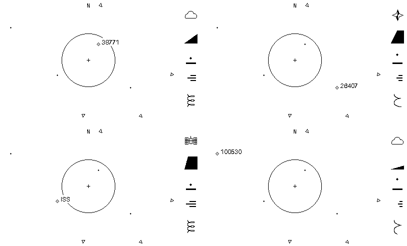

# Overhead — Design

A handheld, realtime satellite radar for a set location, inspired by Nathan
Matsuda's flight-tracking interfaces. A rewrite of “Satellite notifier,” which
used an LED matrix and a position API.

## Hardware
- ESP32-S3-DevKitC-1-N8R8: 8 MB flash, 8 MB PSRAM.
- Adafruit 2.7" Sharp Memory Display (#4694): 400×240, 1-bit; target 20 Hz.
  Handle the panel/ribbon gently during bring-up.

## Interface intent
A location-centered, wide borderless orbital view with a narrow right-hand
strip of selected-satellite glyphs. [0032](decisions/0032-wide-radar-and-selected-satellite-glyphs.md)
records the overall direction, not a completed interface. The simulator retains
[0028's 240×240 square](decisions/0028-borderless-square-viewport.md) and diagnostic
panel by default. [0033's opt-in comparison](decisions/0033-wide-radar-comparison-contract.md)
implements a 352×240 comparison radar with vertical FOV and per-satellite
off-screen arrows. The user approved this layout and overlaps-allowed treatment.
[0036](decisions/0036-shared-glyph-capsule.md) adds a shared rounded glyph capsule
as visual direction only; glyph mappings and implementation remain open.

Zoom ranges from local to wider than Earth. Motion should feel fluid and lively;
minimum on-screen traversal time for fast markers is planned, not implemented.
**Readouts always use true physical state, never visually slowed markers.**

The visual brief is **alive and active, but not busy**. User-supplied Are.na
references span purpose-built audio instruments, aviation/GPS readouts, compact
technical diagrams and monochrome/dot graphics. These guide exploration, not a
requirement to add dashboard density or decorative activity indicators.

A responsive, full but legible radar is the priority, not a particular satellite
count. Curate and tune density on the small 1-bit display: tens may work better
than hundreds. Pass prediction remains useful but secondary to radar quality
([0021](decisions/0021-radar-first-iteration-on-verified-engine.md)).

The radar is a north-up perspective view of actual 3D satellite positions,
from a fixed camera above the configured observer looking down toward that
location. Lens zoom narrows or widens the field of view without moving the camera.
Earth and satellites share the perspective; altitude affects marker placement,
and satellites can appear outside Earth's silhouette rather than being flattened
onto its surface. Objects outside the view or behind the camera are clipped;
zoom alone cannot move an object behind the camera.
[0024](decisions/0024-perspective-orbital-view-direction.md) records the 3D direction,
with lens zoom selected in [0025](decisions/0025-fixed-camera-lens-zoom.md).
The implemented contract is [0026](decisions/0026-fixed-camera-perspective-slice.md),
amended by [0027's higher camera](decisions/0027-higher-fixed-camera-overview.md),
0028's default square clipping, and 0033's opt-in rectangular comparison.
See [simulator usage](../sim/README.md#controls-and-view)
for current settings, readout units and comparison modes.

User feedback favors zoom-magnified motion and a fuller satellite overview with
smaller Earth at wide FOV. Preserve breathing room rather than auto-fitting or
adding satellites to fill it; the square choice removes the ring, not that
preference. These choices do not select production counts or capacity.

Only satellites above the local geometric horizon are eligible for markers,
then clipped to the current view—even at whole-Earth zoom. This is the observer's
sky, not a global satellite tracker. Zooming out can reveal additional eligible
objects from the catalogue; catalogue size is not the visible marker count.
Physical passes use a separate configurable
elevation threshold, independent of zoom
([pass semantics](decisions/0012-physical-pass-semantics.md)).

### Selected-satellite presentation

The accepted starting direction is the reference below, not the earlier panel
iterations. It is deliberately symbol-led and minimally labelled, with no menus
or pages. Normal/debug separation from
[0029](decisions/0029-normal-and-debug-presentation-direction.md) remains agreed;
0032 amends which information belongs in the normal view.

**Reference only:** four independent 400×240, strictly 1-bit mockups, prepared
2026-10-15 with Pillow from invented positions and illustrative glyph states.
Top left: five-digit weather ID; top right: navigation; bottom left: ISS/station;
bottom right: six-digit weather ID. IDs are examples, not corresponding measured
states. The PNG is a retained design reference, not a simulator snapshot, golden
test, or physically consistent scene. No `/tmp` assets or generation scripts are
needed to continue; this text owns the intent, not the drawing's exact pixels.

- **Radar:** use the space left of the narrow glyph strip, with a centered aim
  point and shared Earth/satellite projection. The mock uses 352×240 plus a
  48-pixel strip; these dimensions are provisional and now used by the opt-in
  comparison. Keep breathing room and no perimeter border. Earth is not stretched
  to fill the rectangle.
- **Outside-view context:** small hollow, outward-pointing edge indicators for
  above-horizon satellites outside the viewport. Wider zoom brings them into
  view as actual markers. Use one arrow per eligible off-screen satellite;
  overlaps are allowed for the first comparison, without suppression, merging
  or displacement. Convey that there is more to explore, not a guaranteed
  countable tally. No separate population-dot summary, normal-view counts, or
  FOV text.
- **Identification:** bare NORAD ID beside the selected marker, with the sole
  familiar-name exception `25544 -> ISS`. Implemented in the opt-in wide view
  under [0034](decisions/0034-selected-marker-identification.md): right-side text,
  left-side fallback, vertical clamping and transparent overlaps allowed. The
  complete ID stays inside the radar, with the marker rather than at the top of
  the strip. [0035](decisions/0035-label-zoom-visibility.md) hides the text at ≥70°
  vertical FOV and restores it at ≤60°, retaining visibility between thresholds.
  The user reviewed and accepted this behavior for now; thresholds remain
  configurable comparison defaults. Keep the selected diamond visible;
  no fade or dithering. Full names remain diagnostic information.
- **Glyph strip, top to bottom:** category pictogram, elevation, altitude,
  orbital speed, orbital period. Align it near the display's right edge, inside
  one shared rounded capsule under [0036](decisions/0036-shared-glyph-capsule.md):
  1px outline, one centered break on each long side, black on white. No individual
  glyph boxes, internal dividers, routine field labels or required numeric values.
  Category icons in the references are proposals, not a finalized taxonomy.
- **Elevation:** an invisible square footprint, origin at lower left, with the
  region below a ray at the elevation angle filled black. Only the filled shape
  is drawn; its sloping boundary represents the angle. This is the strongest
  accepted glyph treatment.
- **Altitude:** satellite point/diamond separated from a surface bar by a
  variable gap. **Speed:** variable-length motion marks, still exploratory;
  their direction is not a heading. **Period:** a vertical slinky-like coil,
  not an inward-winding spiral; more winding means a shorter period. Favor
  legible, separated turns over dense texture. Non-elevation scales are open.
- **Transitions:** favor glyphs animating toward the new selected satellite's
  values. Intermediate shapes are presentation only, never new physical samples.
  This has not been implemented or given timing/interruption rules.

### Glyph capsule reference

**Reference only:** retained 400×240, strictly 1-bit composite from the 2026-10-16–17
visual session. The radar is the current wide weather/GPS replay at
`2026-10-10T00:00:00Z`, observer `39.007 -104.883 2.187`, 20° vertical FOV
([reproduction inputs](../sim/README.md#wide-radar-comparison)); its pixels are
unchanged apart from converting the light background to white. Pillow added the
illustrative navigation/elevation/altitude/speed/period stack and shared capsule
in the reserved 48-pixel strip. Glyph values are not measurements of the selected
satellite. The mock uses 6-pixel-tall side openings; gap length, padding and radius
are not yet implementation contracts. Only the wrapper treatment is newly
approved. This image supersedes the earlier reference's unboxed treatment, not
its data semantics, and is neither executable output nor a golden test.
No temporary assets or generation scripts are needed to continue.

### Open questions and boundaries

0033 settles the first comparison's vertical FOV/aspect, no-arrow invalid-depth
handling, overlaps-allowed arrow policy and unchanged visible-only selection.
The user approved the current wide layout and allowed arrow overlaps; retain
these rather than adding collision avoidance. 0034 settles the first marker-adjacent
label's placement and overlaps-allowed policy. User review of the crowded overview
led to 0035's configurable clean hide/show refinement, now user-reviewed and
accepted for the current comparison. Define glyph ranges/mappings and unknown/
ambiguous category handling explicitly; don't turn illustrative mock values into
defaults. 0036 settles the shared wrapper's appearance, not glyph scales or timing.

Circular radar with an info brick, surrounding noise fields and unlabelled
visible-population graphs were explored, not selected as replacements. For any
future field experiment, the user's interest is a data-driven visual fingerprint
rather than readable text placed over texture. No field mapping, time-history
policy or implementation is approved; keep such experiments separate from the
accepted wide/glyph direction.

Refined empty-view explanations and incomplete-data/tracking notices are parked
for focused design, not removed as a correctness requirement. The comparison
uses minimal explicit notices; final debug access remains open. A normal view
must not conceal failed/omitted tracking as a complete empty sky, including when
some valid markers remain.

The selected-satellite start/end/peak pass graphic is interesting but deferred;
upcoming-pass lists are not desired. Local time, orbit-data age, range and bearing
are not part of this starting layout. Camera movement/panning, marker slowdown,
new automatic selection policy, fetching and production population/cadence
choices are outside this slice. No radio information or battery indicator.

## Controls
- Simulator: continuous zoom via scroll wheel and up/down arrows.
- Initial device: BOOT button cycles through roughly four zoom presets.
- Knob and optional auto-zoom demo mode come later; neither blocks the prototype.

## Product choices
[On-device SGP4](decisions/0001-on-device-sgp4.md),
[Wi-Fi elements/SNTP](decisions/0002-data-and-time-over-wifi.md),
[curated catalogue](decisions/0003-curated-catalogue.md)
(scale tuned through [0021](decisions/0021-radar-first-iteration-on-verified-engine.md)), and
[configured location](decisions/0004-hardcoded-location.md) are settled;
follow those records for rationale and constraints. Implementation order and
deferred scope belong to [PLAN.md](PLAN.md).
