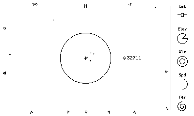

# Overhead — Design

A handheld, realtime satellite radar for a set location, inspired by Nathan
Matsuda's flight-tracking interfaces. A rewrite of “Satellite notifier,” which
used an LED matrix and a position API.

## Hardware
- ESP32-S3-DevKitC-1-N8R8: 8 MB flash, 8 MB PSRAM.
- Adafruit 2.7" Sharp Memory Display (#4694): 400×240, 1-bit; target 20 Hz.
  Handle the panel/ribbon gently during bring-up.

## Interface intent
A location-centered, wide borderless orbital view with a narrow right-hand
strip of selected-satellite glyphs. [0032](decisions/0032-wide-radar-and-selected-satellite-glyphs.md)
records the overall direction, not a completed interface. The simulator retains
[0028's 240×240 square](decisions/0028-borderless-square-viewport.md) and diagnostic
panel by default. [0033's opt-in comparison](decisions/0033-wide-radar-comparison-contract.md)
implements a 352×240 radar with vertical FOV and per-satellite off-screen
arrows; the user approved this layout and overlaps-allowed treatment.
[0038](decisions/0038-labelled-borderless-glyph-direction.md) selects a
borderless labelled glyph stack, circular data glyphs and a padded vertical
separator. The wide view now implements all five static fields
([0041](decisions/0041-circular-elevation-only-contract.md) elevation,
[0042](decisions/0042-static-altitude-glyph-contract.md) altitude,
[0043](decisions/0043-static-speed-glyph-contract.md) speed,
[0044](decisions/0044-static-period-glyph-contract.md) period,
[0045](decisions/0045-static-group-category-contract.md) category, shown since
[0078](decisions/0078-visibility-glyph.md) as naked-eye visibility),
[0046's selected-data transitions](decisions/0046-selected-data-glyph-transition-contract.md),
[0040's white-backed bottom-left notices](decisions/0040-white-backed-bottom-left-notice-contract.md)
and [0047's text-first debug access](decisions/0047-text-first-debug-access-contract.md).
Each was contract-approved, separately authorized and then accepted by the user
on fresh executable output; approved mocks are references, not that evidence.

Zoom ranges from local to wider than Earth. Motion should feel fluid and lively;
minimum on-screen traversal time for fast markers is planned, not implemented.
**Readouts always use true physical state, never visually slowed markers.**

The visual brief is **alive and active, but not busy**. User-supplied Are.na
references span purpose-built audio instruments, aviation/GPS readouts, compact
technical diagrams and monochrome/dot graphics. These guide exploration, not a
requirement to add dashboard density or decorative activity indicators.

A responsive, full but legible radar is the priority, not a particular satellite
count. Curate and tune density on the small 1-bit display: tens may work better
than hundreds. Pass prediction remains useful but secondary to radar quality
([0021](decisions/0021-radar-first-iteration-on-verified-engine.md)).

The radar is a north-up perspective view of actual 3D satellite positions,
from a fixed camera above the configured observer looking down toward that
location. Lens zoom narrows or widens the field of view without moving the camera.
This iteration may reuse prepared coastline geography for a fixed observer during
use; the user would like to keep globe scrolling/panning open for a future
iteration, not require it now. [0057](decisions/0057-fixed-observer-coastline-preparation-scope.md)
scopes that direction without selecting a location UI; [0058](decisions/0058-prepared-wide-coastline-slice.md)
implements a startup-prepared wide-view layer in the simulator, with
[0059](decisions/0059-current-view-coastline-raster-cache.md)'s current-view raster
cache; neither is a device adoption. Earth and satellites share the perspective; altitude affects
marker placement,
and satellites can appear outside Earth's silhouette rather than being flattened
onto its surface. Objects outside the view or behind the camera are clipped;
zoom alone cannot move an object behind the camera.
[0024](decisions/0024-perspective-orbital-view-direction.md) records the 3D direction,
with lens zoom selected in [0025](decisions/0025-fixed-camera-lens-zoom.md).
The implemented contract is [0026](decisions/0026-fixed-camera-perspective-slice.md),
amended by [0027's higher camera](decisions/0027-higher-fixed-camera-overview.md),
0028's default square clipping, and 0033's opt-in rectangular comparison.
See [simulator usage](../sim/README.md#controls-and-view)
for current settings, readout units and comparison modes.

User feedback favors zoom-magnified motion and a fuller satellite overview with
smaller Earth at wide FOV. Preserve breathing room rather than auto-fitting or
adding satellites to fill it; the square choice removes the ring, not that
preference. These choices do not select production counts or capacity.
[0051](decisions/0051-angular-coastline-appearance-direction.md) records a
reviewed **angular 1-bit coastline appearance direction** from 5° through 100°,
including local detail and the tiny wide-end cue, with evidence-gated exploration
down to 0.1°. [0052](decisions/0052-natural-earth-coastline-candidate.md) accepts
Natural Earth 1:110m v4.1.0 as a conditional source candidate only. The
[offline comparisons](mockups/0057-coastline-sampling-comparison.md) are not
executable coastline output. [0054](decisions/0054-first-executable-coastline-comparison.md)
now implements a bounded wide-only host comparison using the user's accepted
40 km orientation look and a checked source export. The user accepted its
fresh executable images and simulator appearance, including the tight-zoom
comparison. This is not a certified no-omission geographic renderer, target-cost
result or production asset. Square/circular modes remain unchanged.

Only satellites above the local geometric horizon are eligible for markers,
then clipped to the current view—even at whole-Earth zoom. This is the observer's
sky, not a global satellite tracker. Zooming out can reveal additional eligible
objects from the catalogue; catalogue size is not the visible marker count.
Physical passes use a separate configurable
elevation threshold, independent of zoom
([pass semantics](decisions/0012-physical-pass-semantics.md)).

### Selected-satellite presentation

The current accepted visual direction is [0038](decisions/0038-labelled-borderless-glyph-direction.md):
symbol-led with short field labels, no enclosing glyph borders, and no menus or
pages. Normal/debug separation from
[0029](decisions/0029-normal-and-debug-presentation-direction.md) remains agreed;
0032 amends which information belongs in the normal view, with glyph treatment
subsequently revised by 0038.

**Reference only:** native 400×240, strictly 1-bit composites from 2026-10-17
with illustrative glyph values that do not describe the selected satellite.
[Provenance and the reviewed strip geometry](mockups/glyph-and-notice-references.md#0038-labelled-glyph-stack);
the implemented contracts own exact geometry.

- **Radar:** use the space left of the narrow glyph strip, with a centered aim
  point and shared Earth/satellite projection. The wide view uses 352×240 plus a
  48-pixel strip; these dimensions are provisional. Keep breathing room and no
  perimeter border. Earth is not stretched to fill the rectangle.
- **Outside-view context:** small filled ([0061](decisions/0061-filled-arrows-id-backing-none-in-view.md); originally hollow), outward-pointing edge indicators for
  above-horizon satellites outside the viewport. Wider zoom brings them into
  view as actual markers. Use one arrow per eligible off-screen satellite;
  overlaps are allowed, without suppression, merging or displacement. Convey
  that there is more to explore, not a guaranteed countable tally. No separate
  population-dot summary, normal-view counts, or FOV text.
- **Identification:** bare NORAD ID beside the selected marker, with the sole
  familiar-name exception `25544 -> ISS`. [0034](decisions/0034-selected-marker-identification.md)
  places it right of the marker with left-side fallback, vertical clamping and
  overlaps allowed; 0061 adds a 1px white backing behind the ID text and the
  selected diamond. The complete ID stays inside the radar, with the marker
  rather than at the top of the strip. [0035](decisions/0035-label-zoom-visibility.md)
  hides the text at ≥70° vertical FOV and restores it at ≤60°, retaining
  visibility between thresholds; the user accepted this for now and the
  thresholds remain configurable comparison defaults. The zoom gate retains the
  selected diamond; 0040's notice overlay may locally cover it. No fade or
  dithering. Full names remain diagnostic information.
- **Glyph strip, top to bottom:** visibility pictogram (0078: eye when sunlit
  against a dark sky, filled disc in Earth's shadow, sun in daylight; it replaced
  the category pictogram described next), elevation, altitude,
  orbital speed, orbital period. Keep it near the right edge, without enclosing
  borders; one padded vertical line separates it from the radar. Center short
  labels above each glyph. No routine numeric values. Navigation uses a thin
  square-ended cross; station uses a small outlined body with straight horizontal
  wings (selected option B); 0045 adds the weather cloud and unknown question
  mark, group-based assignment and Station > Navigation > Weather > Unknown
  priority. These four roles are a bounded comparison taxonomy, not
  comprehensive mission or operational-status metadata. No selection clears all
  five fields, retaining the separator.
- **Elevation:** a 1px circle outline with an angular cutout opening upward
  from the rightward horizontal radius; outline the remaining circle and both
  single-pixel radial edges, not the isolated wedge. True observer elevation
  supplies the input (0041).
- **Altitude:** fixed outer circle with an outlined inner circle that shrinks
  as true WGS-84 altitude rises, on 0042's fixed compressed scale spanning low
  Earth, navigation and geostationary heights.
- **Speed:** an increasing circle-outline arc, absent at zero and complete at
  maximum, clockwise from the top rather than a heading: instantaneous TEME
  velocity magnitude on 0043's fixed linear 0–12 km/s scale.
- **Period:** a spiral, replacing the coil; more turns mean a shorter period.
  0044 maps nominal element-set period logarithmically from 90 minutes/2½ turns
  to 24 hours/one turn.
- **Transitions:** glyphs animate toward the new selected satellite's values.
  Intermediate shapes are presentation only, never new physical samples. 0046
  animates `Elev`, `Alt`, `Spd`, `Per` (250 ms) with `Cat` (now `Vis`) switching immediately;
  headless snapshots remain static.

### Retained mock references

Provenance for the approved illustrative mocks of
[elevation](mockups/glyph-and-notice-references.md#circular-elevation-only-contract),
[altitude](mockups/glyph-and-notice-references.md#static-altitude-contract),
[speed](mockups/glyph-and-notice-references.md#static-speed-contract),
[period](mockups/glyph-and-notice-references.md#static-period-contract),
[category](mockups/glyph-and-notice-references.md#static-category-contract),
[bottom-left notices](mockups/glyph-and-notice-references.md#bottom-left-notice-reference)
and the historical [0036 glyph capsule](mockups/glyph-and-notice-references.md#glyph-capsule-reference)
lives in [mockups/glyph-and-notice-references.md](mockups/glyph-and-notice-references.md).
They are contract references, not executable output, golden tests or physical
evidence. [Simulator usage](../sim/README.md#static-category-glyph) owns fresh
executable reproduction.

### Open questions and boundaries

Settled for the current wide view: 0033's vertical FOV/aspect, no-arrow
invalid-depth handling and overlaps-allowed arrows (no collision avoidance);
0034/0035 label placement and zoom visibility; 0041–0045 static field mappings
(illustrative mock values are not defaults); 0046 transitions; 0047 debug
access. 0038 replaces 0036's wrapper and the earlier glyph visual brief; 0041
supersedes 0037; warning placement/compositing remain owned by 0040.

Circular radar with an info brick, surrounding noise fields and unlabelled
visible-population graphs were explored, not selected as replacements. For any
future field experiment, the user's interest is a data-driven visual fingerprint
rather than readable text placed over texture. No field mapping, time-history
policy or implementation is approved; keep such experiments separate from the
accepted wide/glyph direction.

[0049](decisions/0049-stable-wide-selection.md) keeps the selected ID and current
true-state strip when a successfully tracked above-horizon object moves outside
the viewport through zoom or motion. Tab chooses an in-view marker;
horizon/tracking loss ends the selection and falls back to the first in-view
marker. No off-screen diamond, marker-adjacent label or specially marked arrow
is approved. Square diagnostics retain visible-only selection.

[0039](decisions/0039-bottom-left-condition-driven-notices.md) selects bottom-left
notices that follow their underlying conditions rather than expiring:
`NO MARKERS`, `NO FRAME`, `TRACK ERROR` and `INGEST WARN`. Healthy selected views
have no notice ink. [0040](decisions/0040-white-backed-bottom-left-notice-contract.md)
gives them a small borderless white backing that may visually cover markers
(including the selected diamond), IDs, arrows or Earth within its bounds without
changing eligibility, counts, physical state or selection.
[0048](decisions/0048-refined-empty-view-notices.md) refines the wide empty view:
`NONE IN VIEW` (0061's wording; originally `SKY OUTSIDE VIEW`) when there are
eligible arrows, `NONE ABOVE HORIZON` only for a clean nonempty loaded catalogue
with nothing above the horizon, and conservative `NO MARKERS` otherwise.
Independent tracking/ingestion warnings remain, and 0047's debug access does not
replace normal notices. A normal view must not conceal failed/omitted tracking
as a complete empty sky, including when some valid markers remain.

The selected-satellite start/end/peak pass graphic is interesting but deferred;
upcoming-pass lists are not desired. [0050](decisions/0050-keep-range-in-debug-and-defer-display-prediction.md)
keeps range in debug after a [normal-view comparison](mockups/0050-range-vs-no-readout.md)
and defers display prediction, including a countdown study, for now; the existing
physical pass-search engine remains intact. Local time, orbit-data age and bearing
are not part of this starting layout. Camera movement/panning, marker slowdown,
any ranking beyond 0049's agreed selection continuity/fallback, fetching and
production population/cadence choices are outside this slice. No radio
information or battery indicator.

## Controls
- Simulator: continuous zoom via scroll wheel and up/down arrows.
- Intended device ([0060](decisions/0060-defer-timing-to-physical-prototype.md)):
  a button cycles through satellites and a knob zooms continuously; zoom presets
  remain a fallback if the knob proves infeasible.
- The first firmware prototype may start with BOOT-button control; [0068](decisions/0068-boot-selection-gesture.md)
  accepts in-view cycling once per completed debounced press, with no queued
  press across invalid frames. The provisional GPIO0/20 ms experiments do not
  set device timing or implement the knob. Optional auto-zoom demo mode comes
  later; neither blocks the prototype.

## Product choices
[On-device SGP4](decisions/0001-on-device-sgp4.md),
[Wi-Fi elements/SNTP](decisions/0002-data-and-time-over-wifi.md),
[curated catalogue](decisions/0003-curated-catalogue.md)
(scale tuned through [0021](decisions/0021-radar-first-iteration-on-verified-engine.md)), and
[configured location](decisions/0004-hardcoded-location.md) are settled;
follow those records for rationale and constraints. Implementation order and
deferred scope belong to [PLAN.md](PLAN.md).
