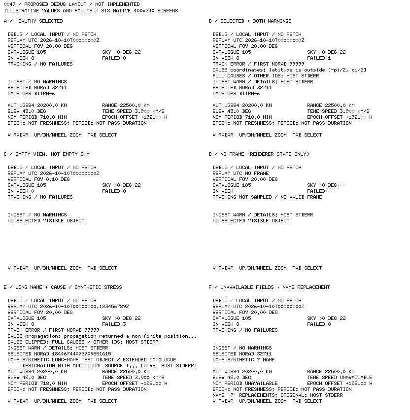

# 0047 — Approved debug-page layout reference

**User approved the layout and overflow treatment; not yet implemented.**
[0047](../decisions/0047-text-first-debug-access-contract.md) records this approval
alongside the content, access and state invariants. This reference specifies the
accepted bitmap text fit, formatting and overflow behavior. Layout approval is
separate from implementation authorization and executable visual acceptance;
it does not change the current wide radar, square default, CLI or host logging.

## Accepted layout

Use a fixed, radar-free page with tracking/data-health status above selected
identity and values. Keep row positions stable when warnings appear. Reserve
one cause row and two name rows; explicitly identify shortened or substituted
text and direct the reader to the existing host stderr report. Do not add
scrolling, extra pages, shrinking fonts or a debug snapshot option.

The user reviewed the six illustrative pages and approved this layout, numeric
formatting and bounded-text treatment. This closes the preimplementation renderer
review, not the subsequent implementation or executable-review gates.

## Geometry

- 400×240, black on white, strictly 1-bit. No radar, glyph strip, boxes or rules.
- Existing embedded-graphics 0.8.2 ASCII `FONT_6X10`: 6×10 cells, zero character
  spacing, baseline 7px below cell top. No new font/dependency.
- Text starts at `x=8`; 64 cells span `x=8..391`. Paired fields use independent
  32-cell columns at `x=8` and `x=200`; neither may spill into the other.
- Eighteen fixed rows, cell tops `y=12 + 12*row`, baselines `y=19 + 12*row`.
  The last cell ends at `y=225`, leaving 14px below. Clear/redraw the whole page;
  blank rows must not retain a previous name, value or failure cause.

| Row | Cell top | Content |
|---|---:|---|
| 0 | 12 | `DEBUG / LOCAL INPUT / NO FETCH` |
| 1 | 24 | `REPLAY UTC` and supplied/replayed UTC, or `NO FRAME` |
| 2 | 36 | `VERTICAL FOV` in degrees |
| 3 | 48 | `CATALOGUE` count / `SKY >0 DEG` above-horizon count |
| 4 | 60 | `IN VIEW` count / `FAILED` count |
| 5 | 72 | Tracking status, or `TRACK ERROR / FIRST NORAD` and complete ID |
| 6 | 84 | First failure's current `CAUSE`, if any |
| 7 | 96 | Failure detail/overflow guidance to host stderr, if any |
| 8 | 108 | `INGEST / NO WARNINGS` or `INGEST WARN / DETAILS: HOST STDERR` |
| 9 | 120 | `SELECTED NORAD` and complete ID, or `NO SELECTED VISIBLE OBJECT` |
| 10–11 | 132, 144 | Full available name where it fits; bounded continuation below |
| 12 | 156 | `ALT WGS84` km / observer `RANGE` km |
| 13 | 168 | `ELEV` degrees / `TEME SPEED` km/s |
| 14 | 180 | `NOM PERIOD` minutes / signed `EPOCH OFFSET` hours |
| 15 | 192 | `EPOCH: NOT FRESHNESS; PERIOD: NOT PASS DURATION` when selected |
| 16 | 204 | Name-character substitution warning when needed; otherwise blank |
| 17 | 216 | `V RADAR  UP/DN/WHEEL ZOOM  TAB SELECT` |

The fixed blank cause/name rows in healthy/short-name examples are intentional:
warning visibility takes priority over filling space. `SKY >0 DEG` means true
observer elevation above zero, not pass-search eligibility or a global count.
Category is omitted; it is not a tracking-health or operational-status field.

## Formatting and absence rules

- UTC: ISO date/time with `T` and `Z`; preserve supplied/replayed fractional
  seconds up to nanosecond precision when nonzero. Do not substitute host time.
- FOV: two decimal places. Counts and NORAD IDs: complete decimal integers,
  never rounded, saturated or shortened. The count columns fit even a 20-digit
  `u64` value with their labels; this is a text-fit check, not a capacity limit.
- Altitude/range: one decimal place in km. Elevation: one decimal place in
  degrees. TEME speed: three decimal places in km/s. Nominal period: one decimal
  place in minutes. Epoch offset: explicit sign and two decimal places in hours.
  Compute from the actual time difference, not a rounded displayed UTC.
- For a finite numeric field whose ordinary fixed-decimal text would exceed its
  32-cell column, use explicit scientific notation with three significant digits,
  retaining label, units and the epoch sign. Do not clip digits or clamp physical
  values. This fallback is accepted behavior, not an implemented formatter.
- Missing/nonfinite individual values show `UNAVAILABLE` in their own field;
  nominal period also requires a positive value. Other selected values remain.
  The label preserves field meaning when there is no numeric value/unit suffix.
- No selected visible object: keep the status/count area, but omit both name
  rows, all six selected values and their qualifier. No stale values or off-screen
  selection. A zero in-view count does not imply a complete empty sky.
- No valid frame: retain the accepted catalogue count and lens setting, show
  `--` for the three unsampled frame-dependent counts, and say
  `TRACKING NOT SAMPLED / NO VALID FRAME`. This is a presentation of unavailable
  counts, not a change to `RadarApp::counts()`. Omit selected values.
  The current simulator still exits on fatal clock errors; this is a renderer
  state, not a proposed persistent host error screen.

## Text bounds

### Failures

Use the first failed object in the app's existing ascending-NORAD iteration;
show its full ID independently of its cause. The failure count remains visible
when successful markers/selection also exist.

One 64-cell cause row includes the `CAUSE ` prefix. If the complete formatted
cause fits, show it in full. Otherwise reserve the final three cells for `...`
and show `CAUSE CLIPPED; FULL CAUSES / OTHER IDS: HOST STDERR` on row 7. Without
clipping, row 7 says `FULL CAUSES / OTHER IDS: HOST STDERR`. This is explicitly
one object's cause, not a complete list of current failures. If any unsupported
cause characters require replacement, identify the cause as changed on row 7
as well; `CAUSE SHORTENED/CHANGED; FULL DETAILS: HOST STDERR` fits the same row.
No failure means both detail rows are blank.

The app's current error strings are printable ASCII. Causes in the sheet use
current error wording, but the fault combinations are illustrative controls,
not reported replay events. The simulator's existing changed-failure-set stderr
report remains the complete source; ingestion detail stays in its existing host
report too. No renderer logging or log history is proposed.

### Names

Two rows with `NAME ` on the first and a five-space indent on the second give
59 cells per row. Wrap at spaces; hard-wrap a token longer than a row. Do not
alter the underlying catalogue name. If more text remains after two rows,
reserve the end of the second row for `... [MORE: HOST STDERR]`. This explicitly
bounds the on-screen name rather than presenting a prefix as the full name.

Absent/empty names show `NAME UNNAMED`. Unsupported/nonprintable characters are
replaced by `?`, with `NAME '?' REPLACEMENTS; ORIGINAL: HOST STDERR` on row 16.
An ordinary literal question mark alone does not trigger that warning. Names
cannot inject new rows. Both shortening and substitution indicators may coexist.
The existing accepted-catalogue stderr report already includes the full selected
element name under its NORAD ID; this layout needs no new logging behavior.

## Cases and provenance

Prepared on 2026-10-18 for review. The retained PNG is an **832×852 contact sheet**
with six native 400×240 pages; headings outside each page are review annotations,
not debug UI. Screen origins in the sheet are `(8,53)`, `(424,53)`, `(8,323)`,
`(424,323)`, `(8,593)`, `(424,593)`.

- **A:** healthy selected object with all values.
- **B:** selected object alongside one tracking failure and ingestion warning;
  a complete short cause fits.
- **C:** zero in-view objects but 22 above the horizon; no selected values.
- **D:** no valid frame plus an ingestion warning; unsampled counts are not zero.
- **E:** synthetic long name, complete 20-digit selected ID, three failures,
  a clipped cause, fractional UTC and a negative epoch offset. Full available
  name text extends beyond both name rows; both truncation notices are deliberate.
- **F:** synthetic unsupported name character and unavailable speed/period;
  other selected fields and tracking status remain independent.

**All numbers, names-as-assigned, identities and fault combinations are layout
illustrations, not newly computed physical samples.** Familiar counts/identity
in A are convenient placeholders; the altitude, range, elevation, speed, period
and epoch offset were not derived for that object. E's maximum-width ID is a
synthetic formatting control, not a real satellite. F's availability controls
are defensive display states, not an assertion that this replay produces them.

Pillow (already installed) composed the sheet using the existing font atlas.
The atlas bytes were checked against the renderer's raw font bytes, not a
system-font approximation. Bounds checks covered 64-cell rows, independent
32-cell columns, native page margins and strict binary PNG pixels. No simulator
was launched, no Rust code changed, no orbital fixture was modified and no
dependency was added. The retained image, geometry/text rules and existing font
suffice to reconstruct these references without the disposable preview script.
These are not executable snapshots, golden tests, or physical-display/target
performance validation. The user subsequently approved the native-size layout
and overflow treatment. The retained PNG's proposal heading records its origin;
its pixels have not changed with approval.

## Next gates

After separate implementation authorization, implement 0047 in simulator
configuration/input and an independent renderer page. Preserve app truth, wide geometry, normal notices, static
headless snapshots and square defaults. Prefer a fresh static wide frame on
return rather than resuming a hidden glyph transition. Test option conflicts,
toggles, Tab/zoom while debugging, absent/partial/failed frames, long text,
formatting boundaries and unchanged normal pixels. Run workspace checks/tests
and seek separate executable visual acceptance. Nothing here authorizes a debug
`--snapshot` option, new selection policy, fetching, prediction or hardware work.
