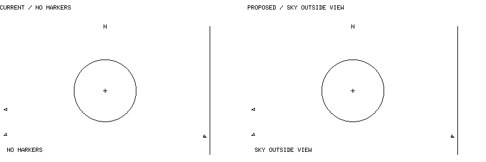
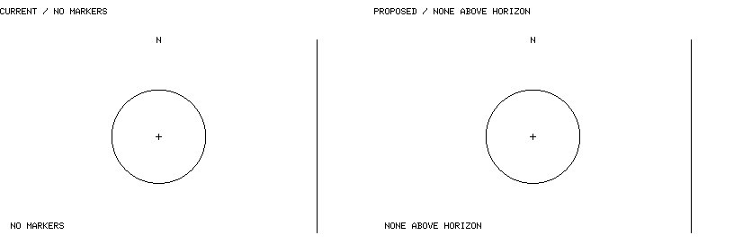

# 0048 — Empty-view notice comparison references

These strictly 1-bit **illustrative composites** were reviewed on 2026-10-18
alongside the wording/backing contract now accepted in
[0048](../decisions/0048-refined-empty-view-notices.md). The new notices shown
on the right are not executable renderer output or executable visual acceptance.
At the time of capture, the source executable used `NO MARKERS` for both scenes.
The decision owns the state rules; [simulator usage](../../sim/README.md) documents
the subsequent implementation. These retained sheets remain historical mocks.

`--demo --wide --snapshot` at `2026-10-10T00:00:00Z`, observer
`39.007 -104.883 2.187`, default 20°: 16 accepted, four above horizon,
zero visible, four arrows and no failures. The left-hand scene comes from the
existing executable's native 400×240 headless snapshot, converted from
LcdWhite to pure black/white. The right-hand scene changes only the notice
text and its backing. Four indicators are a catalogue-specific observation,
not a whole-sky tally or production population choice.

One ISS record from the existing `core/tests/fixtures/iss-25544.json` at
`2026-10-04T12:43:41.833056Z`, the same observer/20° wide view: one accepted,
zero above horizon, zero visible, zero arrows and no failures. This is a
**loaded-catalogue** result, not evidence of a completely empty sky. The left
scene is the existing headless snapshot; the right replaces only its notice.
The temporary one-record manifest and original headless PNGs were under `/tmp`.
No tracked fixture or source data was changed.

Each sheet is 816×272 with two 400×240 native scenes and a 16px gutter;
headings are outside the scenes. The binary mock text uses the existing locked
`embedded-graphics` 0.8.2 `FONT_6X10` bitmap, not a system font. The demo's
original-notice panel was checked pixel-identical to the executable screenshot
once converted to binary. Changes are confined to the union of old/new notice
backing bounds; radar geometry and other pixels are not redrawn. The 18-cell
horizon text widens the backing to 112px under the accepted contract. No
package, renderer code or firmware was added to produce these references.
These sheets are neither golden tests, physical-display legibility checks nor
target-performance evidence.
