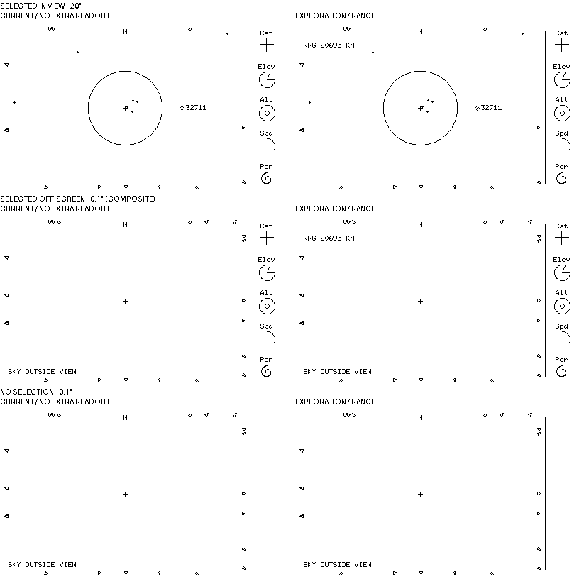

# M4 range-versus-no-extra-readout comparison (reviewed; no addition)



**Review outcome:** the user chose to leave range in debug; no normal-view
range readout is approved. This does not settle other M4 secondary information.
The candidate remains an illustrative comparison, not an executable renderer.
Each row compares two
400×240 native-size, strictly 1-bit scenes with a 16px gutter; headings outside
the scenes are review annotations. The question is whether the selected object's
true *observer slant range* earns space in the wide normal radar, including when
0049 retains selection off-screen. Range is not altitude, screen-edge distance,
pass timing or a prediction. The existing five-field strip, notices and
visible-only marker/arrow styling are unchanged. The third row intentionally
shows no range without selection, even though the viewport has arrows.

## Sources and construction

At source revision `d43c3bb`, generate temporary headless snapshots from the
workspace root (no SDL window or network fetching):

```sh
cargo run -q -p overhead-sim -- sim/examples/weather-gps.json \
  2026-10-10T00:00:00Z 39.007 -104.883 2.187 \
  --wide --fov-deg 20 --snapshot /tmp/selected.png
cargo run -q -p overhead-sim -- sim/examples/weather-gps.json \
  2026-10-10T00:00:00Z 39.007 -104.883 2.187 \
  --wide --fov-deg 0.1 --snapshot /tmp/narrow.png
cargo run -q -p overhead-sim -- sim/examples/weather-gps.json \
  2026-10-10T00:00:00Z 39.007 -104.883 2.187 \
  --fov-deg 20 --snapshot /tmp/diagnostic.png
```

The top baseline is the wide 20° output (105 accepted, 22 above horizon, eight
visible, 14 arrows, zero failures), which selects NORAD `32711`. The square
20° diagnostic panel also selects `32711` at the same UTC/site and reports
`RNG 20695 KM`. This is a rounded true observer-range reading from the
existing app/renderer, **not** orbit-data age, inferred freshness or a made-up
value. The bottom baseline is the wide 0.1° output (zero visible, 22 arrows,
zero failures), which starts with no selection.

The middle **illustrative composite is not a headless capture of selection
continuity**: copy only the 48px selected strip (`x=352..399`) from the wide
20° output onto the same-UTC/site narrow radar, preserving all narrow radar
pixels and its `SKY OUTSIDE VIEW` notice. This depicts retaining `32711` after
zooming in from 20° to 0.1°, as allowed by [0049](../decisions/0049-stable-wide-selection.md);
the standalone narrow snapshot cannot retain selection history. It does not
claim that a particular interactive zoom sequence was run or that its glyph
transition would be at this endpoint. Actual interactive behavior is documented
in [simulator usage](../../sim/README.md#wide-radar-comparison).

The candidate adds **only** `RNG 20695 KM` at radar `x=12..83`, `y=26..35` in
the two selected scenes, without a backing mask. Its 6×10 bitmap ink is copied
from the square diagnostic screenshot at `x=250..321`, `y=146..155`; headings
use a host font outside the native scenes. LcdWhite source pixels were
thresholded to binary. The no-selection pair is pixel-identical. Checks during
composition found 156 candidate-only changed ink pixels in each selected
scene, all within that 72×10 area; the final PNG is 816×816 1-bit. The
disposable source PNGs and composition script were kept outside the repo; this
retained image and these crop/placement rules preserve the comparison. No app,
renderer, fixture or dependency was changed.

## Review gate

The number offers exact observer context absent from the five glyphs, especially
when the selected marker has left the viewport. But it introduces routine numeric
ink into a deliberately spare radar, may cover moving markers/arrows, and could
be mistaken for a distance *to the viewport edge*. Range is already available
on the debug page; the current-design starting layout explicitly omits it
([DESIGN](../DESIGN.md#open-questions-and-boundaries)). The review question was
whether this number answered a routine normal-view need strongly enough to
justify its ink. The user chose **no range addition**: retain the current normal
view and existing debug range. This mock does not revise that design boundary
or authorize implementation. It is not a golden test, physical-display
validation or target-performance evidence.
