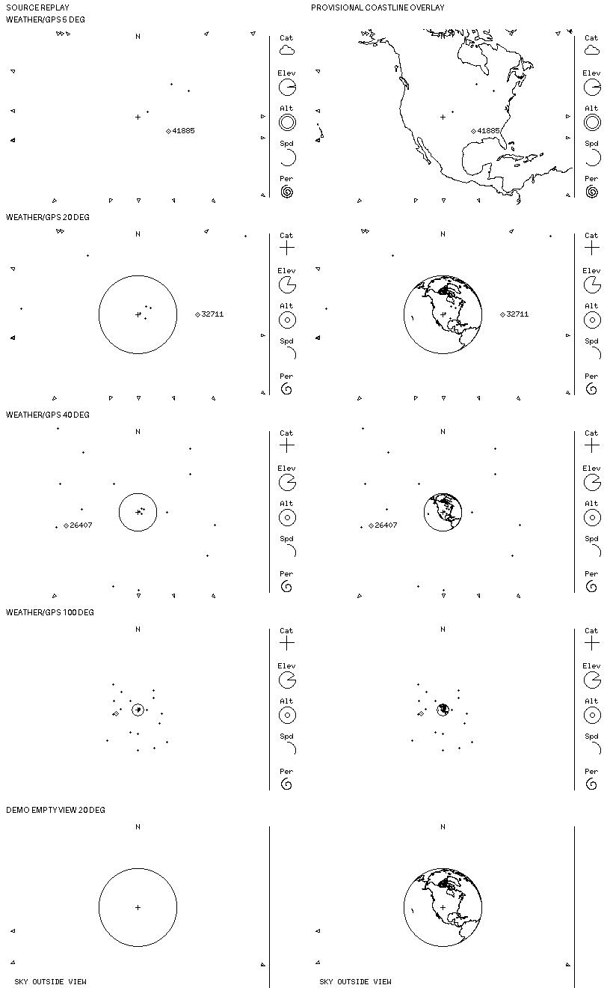

# M4 — Provisional coastline legibility comparison

**Comparison only; not a coastline source, occlusion, or renderer decision.** The
user authorized evaluation of an offline candidate and subsequently reviewed
the comparison: the 20° treatment looks worth pursuing. That feedback does not
adopt the source, settle zoom/detail rules, or authorize implementation. Each
cell is an unscaled 400×240, 1-bit image. Left cells are fresh headless `overhead-sim` output; right cells add **offline Python/Pillow**
coastline ink to those frames. The right cells are *not* executable renderer
snapshots, tracking evidence, or physical-display validation. Headings and
margins are outside the 400×240 scenes.

## Candidate and provenance

- [Natural Earth 1:110m coastline](https://www.naturalearthdata.com/downloads/110m-physical-vectors/110m-coastline/), version **4.1.0** as declared by the downloaded archive's `ne_110m_coastline.VERSION.txt`. The archive's `.prj` declares geographic WGS-84; the layer includes ocean coastline and major islands, not every lake/river. Its 134 shapefile polylines have 5,128 vertices. Archive fetched for this disposable comparison from `https://naturalearth.s3.amazonaws.com/110m_physical/ne_110m_coastline.zip`; SHA-256 `664449b39070027e882abb295974d182afec18ca21107273d17e9e8bf6f64817`. The download was **not** added to the repo.
- [Natural Earth's terms](https://www.naturalearthdata.com/about/terms-of-use/) describe its data as public domain, usable and modifiable without permission or required attribution. This provenance record is not an approval to ship that dataset or a complete review of upstream accuracy.
- Inputs: `sim/examples/weather-gps.json` at `2026-10-10T00:00:00Z`, observer `39.007 -104.883 2.187`, `--wide --fov-deg 5/20/40/100`; the bottom row uses `--demo --wide --fov-deg 20` at its documented time/site. All five source frames were freshly generated from this checkout with `--snapshot` and no SDL window; the source PNGs were converted to pure binary before compositing. The candidate and disposable generation script lived under `/tmp/overhead-coastline-review`, not the repository.

## Geometry and findings

The offline overlay converts WGS-84 latitude/longitude on the **zero-height
ellipsoid** to ECEF, then uses the same fixed 75,000 km-above-observer camera,
local east/north/up axes, pinhole vertical FOV, 173×117 drawable half-extents,
and 352×240 wide radar as `app/src/projection.rs` and `render/src/lib.rs`.
It keeps surface samples whose outward-ellipsoid-normal dot product toward the
camera is **positive**, rejects nonpositive (rear-facing) samples, and clips
before rounding to the wide viewport.
Adjacent geographic vertices are **linearly interpolated** at no more than
0.2° in latitude/shortest longitude, then joined only when both sample endpoints
are visible. This is an approximate offline visibility and raster test, **not**
a proven horizon-crossing clipper or a proposed on-device data format. Source
black ink is preserved; coastline is OR-composited in black, so it can visually
join existing ink rather than establishing a renderer draw order. No satellite
occlusion or physical horizon eligibility is changed.

| FOV / scene | Preview coastline ink within 400×240 | New black pixels vs source | Native-size observation |
| --- | ---: | ---: | --- |
| 5°, selected | 2,343 | 2,333 | Land edges dominate the open radar; near-edge coastline fragments compete with arrows. The existing Earth limb is outside view. |
| 20°, selected | 1,164 | 1,111 | Recognizable continental outline inside the limb, but clustered northern detail merges into a dark patch. Selected marker/ID and strip remain present. |
| 40°, selected | 474 | 431 | Land shape is still discernible, but limb/line crossings and small features join at 1 px. |
| 100°, selected | 96 | 65 | Globe is tiny; coastline mostly becomes unresolvable ink around the aim point. |
| 20°, no in-view marker (demo) | 1,164 | 1,111 | `SKY OUTSIDE VIEW` and arrows remain legible; geography does not make the loaded catalogue complete or imply an upcoming pass. |

This suggests a zoom-dependent detail/ink policy deserves comparison **before**
selecting a data scale or implementing anything. In particular, at 100° a
coastline may add little beyond the existing limb; at 5° it can overwhelm the
scene. Do not infer physical-panel contrast, memory footprint, render cost,
production scale, or correct pixel-perfect occultation from these composites.

## Open gates

A future implementation proposal needs separate agreement on whether coastlines
are shown at each zoom, source/version and preprocessing, segment clipping at
the tangent boundary, raster/draw order where coastlines meet markers/notices,
and runtime storage/work budget. [0026's camera contract](../decisions/0026-fixed-camera-perspective-slice.md)
currently promises a limb **without** a filled occlusion mask or a separate
camera-occultation rule for satellites; this comparison changes neither. M2
capacity/scheduling and target/physical-display checks remain open. No Rust
source, fixture, dependency, or runtime path changed in this comparison.
