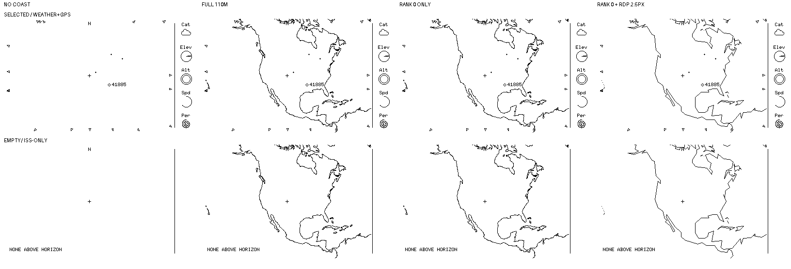
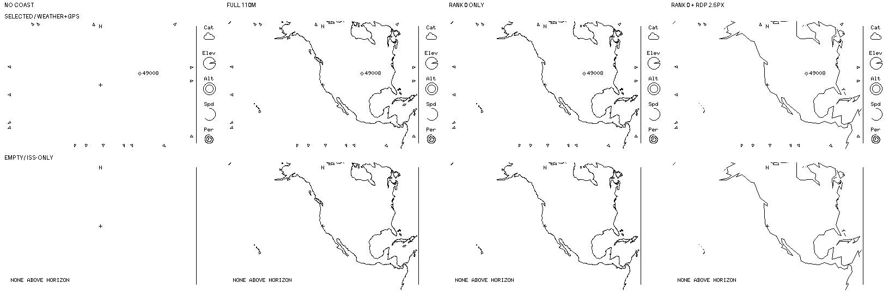

# M4 — Local coastline at 5°: provisional detail comparison

The user said 5° coastlines are important enough to pursue after the [initial 20° comparison](0051-coastline-legibility-comparison.md). This is the next **offline visual comparison**, not a source, simplification, zoom-policy or renderer decision. Both sheets contain native, unscaled 400×240, **strictly 1-bit** scenes. Headings sit outside the scenes.

## Inputs and variants

- Source is the same [Natural Earth 1:110m coastline v4.1.0 candidate, archive hash, public-domain provenance and WGS-84 projection described in 0051](0051-coastline-legibility-comparison.md). Nothing was imported into the repo as runtime data. `overhead-sim` was freshly built from this checkout and ran **headlessly** with `--snapshot --wide --fov-deg 5` and UTC `2026-10-10T00:00:00Z` for two observers: Colorado `39.007 -104.883 2.187` and coastal San Francisco `37.7749 -122.4194 0`. These are review inputs, not device-location choices.
- **Selected:** `sim/examples/weather-gps.json`; Colorado has 4 markers/18 arrows, San Francisco 1 marker/17 arrows. **Empty:** `tools/examples/catalogue.json` is **ISS-only**, not a pool; both sites have zero visible markers, zero arrows and clean `NONE ABOVE HORIZON` notices. These statuses describe only the loaded catalogue at that time. No failures were reported. The no-coast column is actual simulator output converted to binary; other columns add coastline pixels **offline**, never through the renderer.
- **Full 110m:** all 134 shapefile coastline polylines, with intermediate WGS-84 geographic samples spaced at most 0.2° of latitude/shortest longitude, camera-facing test and wide viewport clipping as in 0051.
- **Rank 0 only:** retain the 75 polylines whose candidate archive DBF `scalerank` is `0`, omit the 59 marked `1`. This is an exploratory field filter, not an agreed interpretation of rank or a new data source.
- **Rank 0 + RDP 2.5px:** on each contiguous *visible* sampled run, apply Ramer–Douglas–Peucker reduction in **projected pixel coordinates** at a 2.5px distance tolerance, then connect the retained points with 1px lines. It is deliberately a strong screen-space stress case, not a proposed runtime algorithm or packed map. Hidden/off-viewport gaps are not intentionally bridged, but tangent crossings are only sample-approximated.

All variants OR black coastline ink with the source black ink; the strip and existing marker/notice ink remain unchanged, but ink can join where it overlaps. The intended foreground ordering in the [unapproved rules proposal](0051-coastline-rules-proposal.md) is **not** executable in these images.

| Site | Full ink pixels | Rank-0 ink | Rank-0 + RDP ink | Selected scene's newly black pixels, respectively |
| --- | ---: | ---: | ---: | --- |
| Colorado | 2,343 | 2,181 | 1,630 | 2,333 / 2,171 / 1,627 |
| San Francisco | 1,998 | 1,859 | 1,389 | 1,994 / 1,855 / 1,386 |

## What the comparison shows—and does not

Rank filtering removes relatively little ink; the aggressive pixel simplification removes more but visibly angularizes the continental coast and can create coarse geometric shortcuts. **After reviewing the sheets, the user said they kind of dig the simplified look.** Treat that as encouraging visual feedback, not approval of RDP, 2.5px, rank filtering, a dataset, or implementation. Neither variant guarantees local legibility. In the fixed 75,000-km camera, **5° vertical lens FOV still shows a large continental region** at these sites: it is not a city-scale map. The 1:110m candidate does not make the San Francisco Bay a readable local feature here. This is a reason to test scale/detail or visibility at other sites, not to infer that a different source or extra ink is already approved. Selected IDs, arrows and the no-horizon notice remain present, though collisions and apparent clutter need user review at native size.

The [subsequent 5°–20° progression](0053-coastline-zoom-progression.md)
compares the angular treatment with the full 20° reference; the
[40°–100° overview](0054-coastline-overview-comparison.md) follows it. Neither
comparison adopts data or specifies a runtime algorithm. Any implementation still needs exact limb/tangent and viewport segment clipping, runtime storage/work budget, layering, regressions and separate authorization. These mocks do not validate physical-panel legibility, target performance, coastline accuracy or satellite camera occultation. No Rust, dependency, fixture, hardware or frozen-M2 evidence changed.
