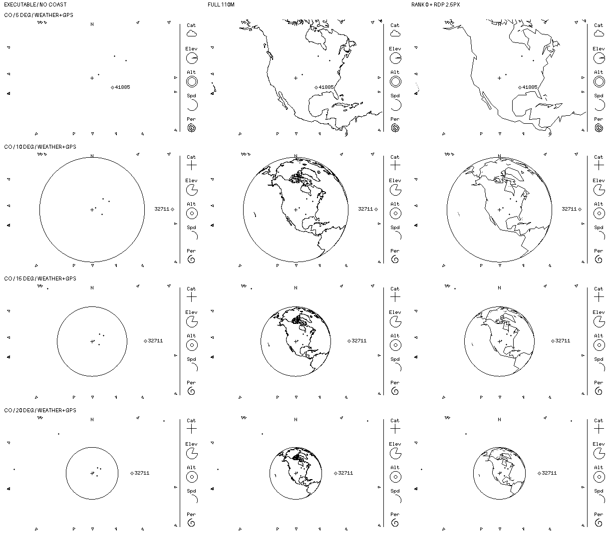
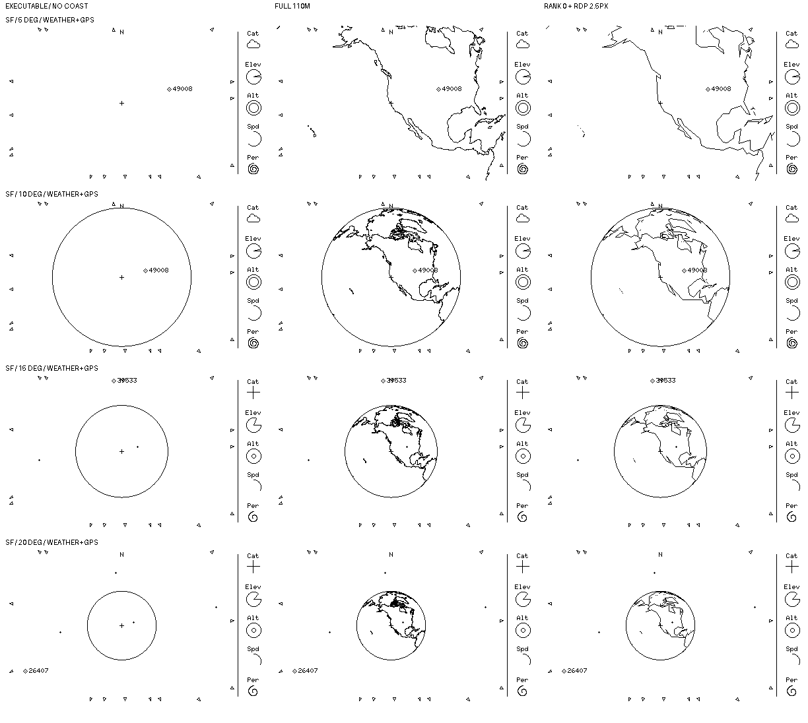

# M4 — Provisional coastline look across 5°–20°

The user tentatively liked the angular simplified 5° look in the [local comparison](0052-local-coastline-comparison.md). This compares that **same offline preview rule** at intermediate zooms against the full-data look already liked at 20°. No data, LOD, threshold, pixel rule or implementation is accepted by this study.

Each unscaled 400×240 cell is strictly 1-bit. Column headings and row labels are outside the cells. Only the **no-coast** column is executable simulator output; the full and simplified columns are offline Pillow OR composites, not renderer output or physical-display evidence. These are separate static snapshots: selected ID and field glyphs may change with FOV because the app initially selects the first in-view marker. They are **not** a continuous interactive selection-replay demonstration.

## Reproduction and scope

A fresh `cargo build -p overhead-sim` preceded headless `--snapshot --wide --fov-deg 10/15/20` at UTC `2026-10-10T00:00:00Z`, with `sim/examples/weather-gps.json` and observers Colorado `39.007 -104.883 2.187` and San Francisco `37.7749 -122.4194 0`. The 5° row reuses the freshly built [0052](0052-local-coastline-comparison.md) source frames. At 10°/15°/20°, Colorado has 5/6/8 markers and 17/16/14 arrows; San Francisco has 1/3/5 markers and 17/15/13 arrows. No tracking failures were reported. The 20° Colorado **full** cell matches [0051's previously reviewed full-line 20° overlay](0051-coastline-legibility-comparison.md) pixel-for-pixel.

The candidate is still the same disposable Natural Earth 1:110m v4.1.0 archive with version/hash/licensing recorded in [0051](0051-coastline-legibility-comparison.md). The full column draws all candidate polylines as sampled camera-facing WGS-84 zero-height surface strokes; the simplified column filters to `scalerank == 0` then applies 2.5px projected-screen Ramer–Douglas–Peucker to each contiguous visible run. Geographic interpolation is capped at 0.2°, and the front/viewport tests and 1px binary OR composition are the same as [0052](0052-local-coastline-comparison.md). This is **not** a device preprocessing method, proven tangent clipper or selected scaling algorithm; no coast data/script was added to runtime code.

| Site / FOV | Full preview coastline pixels | Simplified preview pixels | Observation |
| --- | ---: | ---: | --- |
| Colorado 5° / 10° / 15° / 20° | 2,343 / 2,601 / 1,668 / 1,164 | 1,630 / 1,565 / 972 / 688 | Simplified keeps bold continental shape but loses smaller coast features; 20° is visibly less textured than the full reference. |
| San Francisco 5° / 10° / 15° / 20° | 1,998 / 2,384 / 1,493 / 1,051 | 1,389 / 1,387 / 874 / 603 | The angular style remains across zooms, but detail loss is visible even at 20°. Neither treatment creates city/Bay-scale detail with this camera and source. |

The coastline pixel counts measure only each offline overlay, not renderer cost or occupied pixels after overlap with the existing scene. Higher pixel counts at 10° than 5° can reflect the globe entering view; they do not mean that the underlying coastline data changes. The source marker, notice, strip and physical results are untouched. This comparison has **no** LOD switch, so it cannot establish whether changing from simplified at tight zoom to full at 20° would visibly pop. An always-simplified treatment would avoid that particular switch but would discard detail in the liked full 20° reference.

## Review outcome and next gate

After reviewing the progression and the choice between carrying the angular style through 20° or returning to full detail there, the user said **"ANGULAR STYLE LOOKS GOOD"**. Treat this as visual direction to pursue the angular style across the compared 5°–20° range, rather than forcing a switch back to full detail at 20°. It does **not** approve this particular rank/RDP method, 2.5px tolerance, the source dataset, behavior outside the compared range, or implementation. The [subsequent 40°–100° comparison](0054-coastline-overview-comparison.md) addresses the wider appearance; raster/geometry work still needs bounds before any adoption or renderer authorization.
