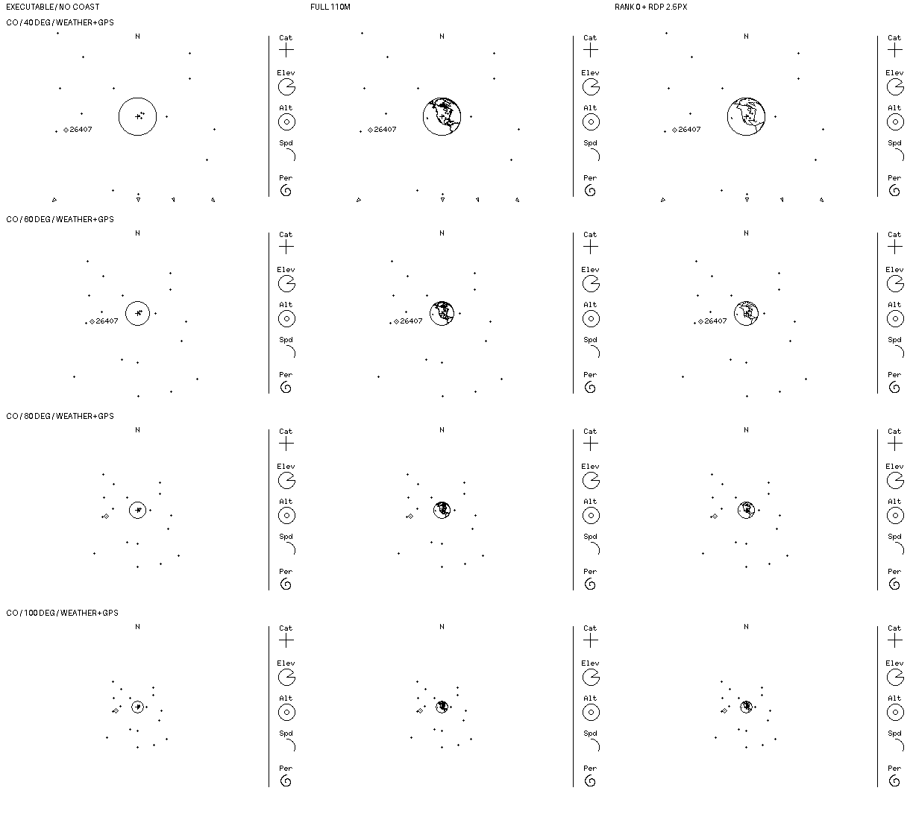
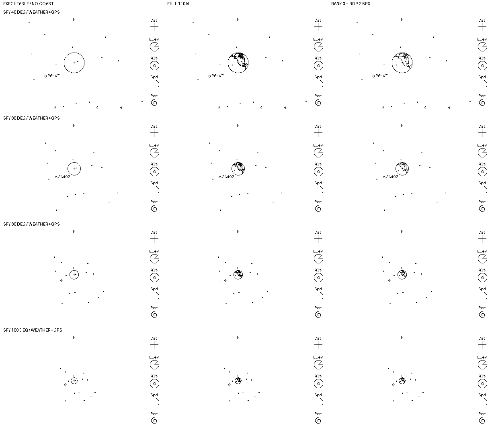

# M4 — Angular coastline toward whole-Earth zoom

The user liked the angular style across the [5°–20° comparison](0053-coastline-zoom-progression.md). This continues the **offline** test at 40°, 60°, 80° and 100°; it does not approve a visibility cutoff, source, algorithm, or implementation. Each unscaled cell in these sheets is native 400×240 and strictly 1-bit. Headings and row labels are outside the cells.

## Inputs and interpretation

As in [0053](0053-coastline-zoom-progression.md), **only the left column is executable** headless simulator output; the full 1:110m and rank-0 + projected 2.5px RDP columns are Python/Pillow OR composites. They preserve existing source ink and the right-hand strip but do not test the proposed real draw order. The same provisional [Natural Earth archive with hash and public-domain provenance](0051-coastline-legibility-comparison.md) supplied camera-facing WGS-84 zero-height coastline samples at no more than 0.2° geographic spacing. Approximate sampled surface/viewport clipping is not a validated tangent-boundary implementation. The simplified column has the same provisional rank filter and pixel-space reduction as 0053; the algorithm and tolerance are **not** selected for the device.

Fresh `cargo build -p overhead-sim` followed by `--snapshot --wide --fov-deg 40/60/80/100` generated source frames at UTC `2026-10-10T00:00:00Z` for `sim/examples/weather-gps.json` at Colorado `39.007 -104.883 2.187` and San Francisco `37.7749 -122.4194 0`. Colorado has 18/22/22/22 visible markers and 4/0/0/0 arrows; San Francisco has 15/18/18/18 markers and 3/0/0/0 arrows. No tracking failures were reported. Static snapshots can acquire different selected IDs as zoom changes; they do not prove interactive selection continuity. The 40° Colorado full preview has 473 coastline ink pixels (431 newly black over its source); earlier 0051's differently sampled full preview measured 474 (431 new), so these are illustrative raster comparisons, not a pixel-golden implementation contract.

| Observer / FOV | Full coastline ink pixels | Angular coastline ink pixels | Angular ink newly black vs source |
| --- | ---: | ---: | ---: |
| Colorado 40° / 60° / 80° / 100° | 473 / 262 / 159 / 95 | 284 / 153 / 101 / 74 | 262 / 135 / 81 / 53 |
| San Francisco 40° / 60° / 80° / 100° | 434 / 242 / 144 / 88 | 251 / 138 / 85 / 63 | 234 / 124 / 74 / 51 |

At 40° the angular land outline is still identifiable; by 60° it is tiny, at 80° it is mostly texture, and at 100° both treatments add black pixels to an Earth disk only about 15px wide. These are judgments for native-size *host* images, not physical-panel legibility or target performance. The sampled 1-bit coast appears to visually merge with the limb/aim point at overview zoom. Hiding coastline near the widest settings would leave the accepted limb and radar untouched, but any on/off transition needs review across adjacent zooms before a threshold or hysteresis is specified. A cutoff is **not** implied by this sheet.

## Review outcome and remaining gates

After reviewing the wide-end comparison, the user said **"Angular throughout is fine."** Carry the angular *appearance direction* through the compared 5°–100° range, including the small coast-texture cue at 80°–100°; do not introduce a visibility cutoff solely because the globe is tiny. This does **not** approve the rank filter, RDP algorithm/tolerance, source dataset, behavior below 5°, exact raster/occlusion semantics or implementation. Any future renderer slice still requires separate source adoption, accurate segment clipping, an explicit bounded format/cost, pixel layering, host regressions and authorization; no Rust, dependency, fixture, hardware or frozen-M2 evidence changed here.
