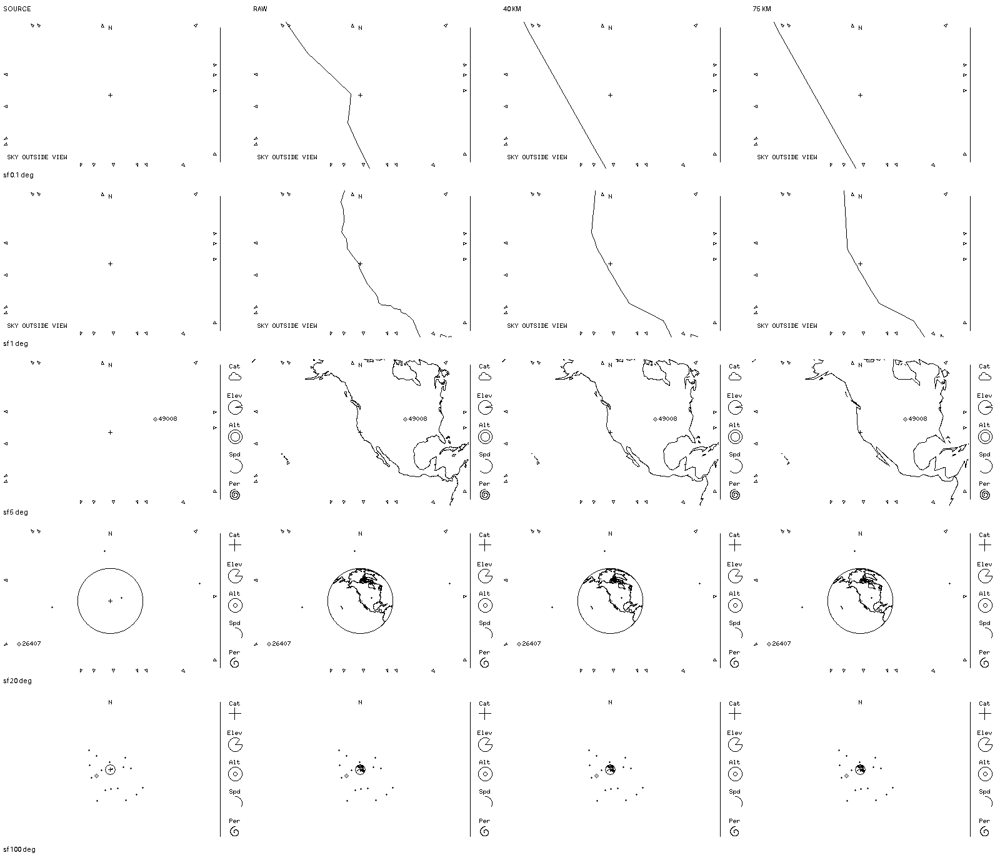
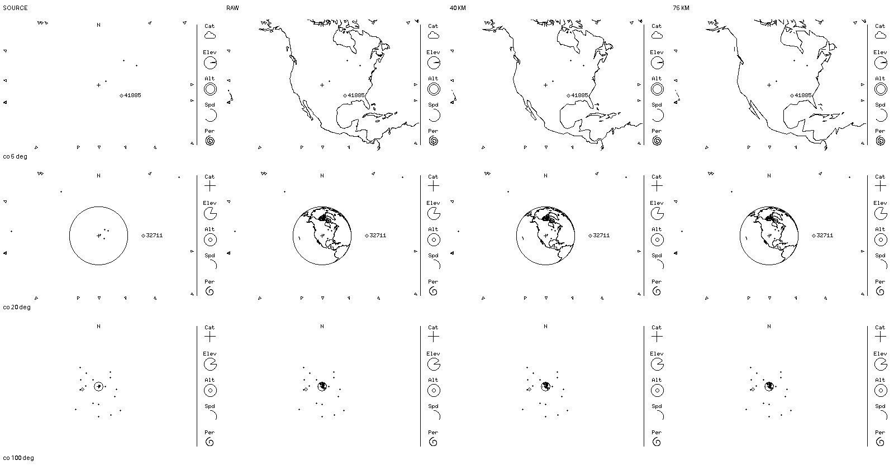

# M4 — Offline coastline reduction and tight-zoom comparison

**For review, not an accepted appearance or raster contract.** Each cell is native, unscaled 400×240, strictly 1-bit; headings and FOV labels are outside the cells. The **SOURCE column only** contains fresh executable `overhead-sim` output. The remaining columns OR black coastline ink over its finished frames using the host-only [reduction/clipping comparison tool and measured report](../evaluations/m4-coastline-reduction-study.md). The overlays are **not** renderer output, proof of draw order, true physical samples, device performance or Sharp-panel legibility. No field glyphs or satellite samples were invented; overlapping ink can still mask a white-backed notice in an untested location.

Rows: San Francisco `37.7749 -122.4194 0` at 0.1°, 1°, 5°, 20° and 100° vertical FOV; Colorado `39.007 -104.883 2.187` at 5°, 20° and 100°. All use `sim/examples/weather-gps.json` at `2026-10-10T00:00:00Z` and opt-in `--wide --snapshot`. The source frames were freshly built and captured from `main` at `91d6f5f` plus docs/offline-tool-only working-tree changes. Every cell in each row shares its source frame; static selection may differ **between** rows, not because of the coastline. The two checked-in sheets contain no separate pixels outside the 400×240 cells except headings/margins. All source and comparison frames and trial binaries are disposable under `/tmp`; the sheets plus [report/tool](../evaluations/m4-coastline-reduction-study.md) retain provenance.

The three offline columns use **all 134 coastline parts** from the pinned Natural Earth 1:110m v4.1.0 archive. RAW keeps all source vertices. 40 KM and 75 KM apply exploratory **3D ECEF RDP per part before projection**, not the older `scalerank == 0` + 2.5px *screen* RDP. They do not represent selected LOD thresholds. The same trial clip (0.2° geographic resampling, front-facing WGS-84 normal and finite tangent bisection, viewport segment clipping before rounding) was used on every variant; it is not yet a proven below-5° error bound, adopted source encoding or executable draw order.

At San Francisco 0.1°, RAW has a bent coast running across the whole radar; 40/75 KM straighten and shift it markedly even though their black pixel counts are close. At 1° some bends disappear; at 5° both are more angular than RAW. At Colorado 5°, 75 KM loses more small geometry than 40 KM; at 20° coast touches/merges with the limb; at 100° all retain the small coast cue. The sheets alone do **not** determine whether either reduced treatment earns the previously accepted [5°–100° angular direction](../decisions/0051-angular-coastline-appearance-direction.md), let alone the newly agreed **exploration** below 5°. Compare these native cells rather than choosing by filesize; no automatic cutoff or detailed new source follows.

**Review outcome:** the user chose **40 KM as the next offline refinement baseline**, not 75 KM. This selects a study direction, **not** the 40 km tolerance as an export/LOD contract or approval of tight-zoom legibility. The measured stored-size gain is much larger than the scan-work gain; the follow-on [quantization/culling diagnostic](../evaluations/m4-coastline-40km-refinement.md) tests one bounded direction, not target readiness. No runtime implementation or asset adoption is authorized by these images.
