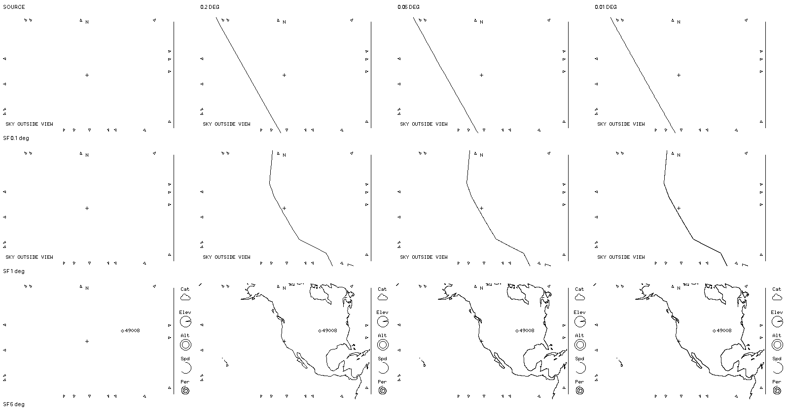

# M4 — 40 km coastline sampling, San Francisco tight zoom

**For review, not an executable coastline or raster acceptance.** Each cell is a native 400×240 strictly 1-bit scene; headings and row labels are outside the cells. Only the **SOURCE** column is fresh headless `overhead-sim` output at `2026-10-10T00:00:00Z`, observer `37.7749 -122.4194 0`, `sim/examples/weather-gps.json`, opt-in `--wide --snapshot`. These are the [0056](0056-coastline-reduction-comparison.md) source frames from this checkout, reused without another simulator build. Each other cell OR-composites an offline coastline mask over exactly the same finished source frame in its row, preserving source black ink and right strip, **not** testing true draw order or white notice-backing occlusion. The coastline columns use all 134 parts of the pinned candidate, exploratory 40 km ECEF reduction, then 0.2°, 0.05° or 0.01° geographic interpolation of the *same* simplified surface curve with finite front-face and viewport clipping. Neither smaller step nor the 40 km tolerance is selected for the device.

At 0.1° the 0.2° stroke looks broadly similar to the finer versions at native size but changes **108 coastline-mask pixels** relative to 0.01°; the intermediate 0.05° version differs from 0.01° by **140**. At 1° the fine stroke gains ink and differs by 120 pixels from 0.2°. At 5° denser sampling adds fine black texture despite nearly straight projected coarse chords. These are *rasterization/rounding-sensitive* 1-bit comparisons, not independent proof of the geographic curve or physical-panel readability. [Exact work and deviation measurements](../evaluations/m4-coastline-sampling-study.md) explain why a fixed finer step alone is not a justified pixel contract.

The 1600×842 sheet is pure binary, with row cells unscaled and margins/headings outside them. Its SHA-256 is `3eb34830a5e60397b3b2bdb558bac3d87d212b6fabc07c9b2806ae5ecf7b2226`. The generator, archive pin, fresh background provenance, comparative masks and bounded synthetic edge/tangent controls live in the [study](../evaluations/m4-coastline-sampling-study.md). Neither these composites nor zero-difference controls approve an asset, algorithm, renderer implementation, 0.1° policy, target performance or physical-panel appearance.
