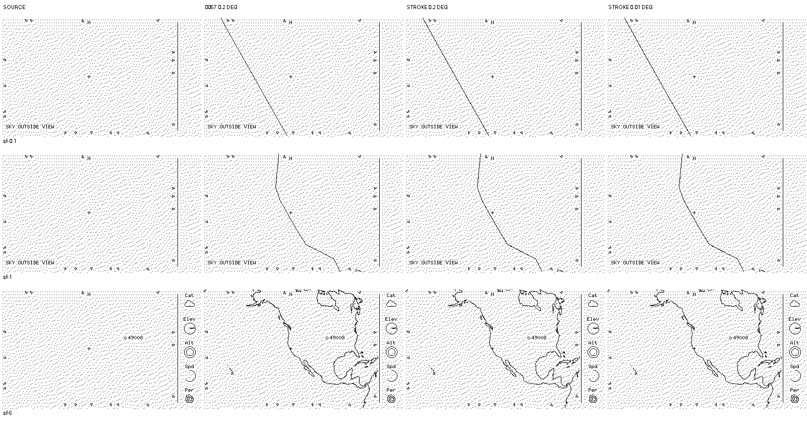

# M4 — offline clipped-stroke comparison at San Francisco

**Not executable coastline rendering or raster approval.** Three rows contain unscaled 400×240 strictly 1-bit scenes at `2026-10-10T00:00:00Z`, observer `37.7749 -122.4194 0`, `sim/examples/weather-gps.json`, opt-in wide view. Only SOURCE is headless no-coast simulator output reused from [0056](0056-coastline-reduction-comparison.md). The other columns OR an offline mask onto each finished frame: 0057's 0.2° Pillow raster, the new continuous clipped-stroke mask at 0.2°, and that mask at 0.01°, all on the same exploratory unquantized 40 km reduction. Source black ink is preserved even where an actual foreground notice should cover background coastlines. The strip and selection do not come from a coastline renderer.

At 0.1° the new coarse and fine stroke masks differ by six coverage-boundary pixels (0057's coarse/fine masks differ by 108). At 1° and 5° they match exactly, but the stroke texture differs from the previous Pillow raster. Native appearance is for review, not evidence of correct coastline detail, junctions, target cost or Sharp-panel legibility. [Method, synthetic controls, limits and reproduction](../evaluations/m4-coastline-stroke-study.md). The 1600×842 retained sheet is pure binary, SHA-256 `69557ae7c3b42f9fa52dbf24047cd4157e14c001d7b586173f834faf9b7117ee`.
