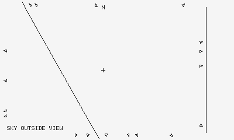
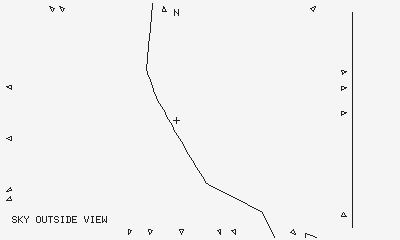
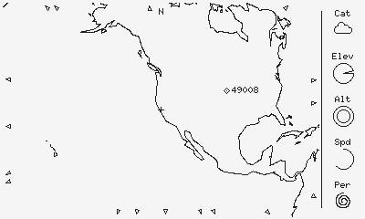
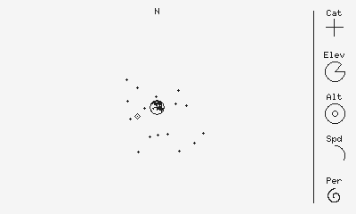
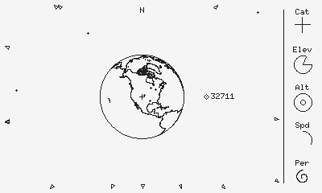
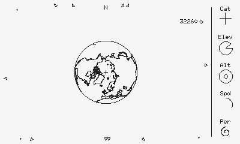
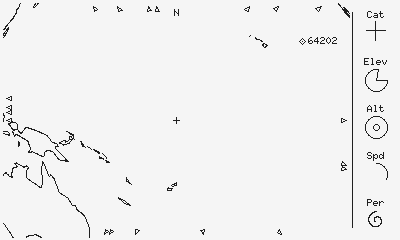

# First executable coastline comparison — visually accepted

**Fresh executable 400×240, two-color PNGs; not contract mocks, golden tests or panel proof.** The user reviewed these images and tried the simulator, confirming that the coastline looks good in both. This accepts their visual appearance, not all clipping cases or device feasibility. Rendered headlessly from the host `overhead-sim` 40 km export in [0054](../decisions/0054-first-executable-coastline-comparison.md), with `sim/examples/weather-gps.json` and UTC `2026-10-10T00:00:00Z`. Every image contains exactly two RGB colors; the renderer uses `BinaryColor`. Satellite values/selection are from the actual replay, not drawn-on reference fields. No no-coast control or physical display comparison is retained here; the renderer test offers a no-coast host control, and the earlier [40 km composites](0056-coastline-reduction-comparison.md) are **offline** rather than executable baselines.

## Coastal San Francisco (37.7749°N, 122.4194°W, 0 km)

| 0.1° — angular close-up | 1° | 5° |
| --- | --- | --- |
|  |  |  |



## Additional sites

| Colorado (39.007, −104.883, 2.187 km), 20° | North polar (89.9, 0, 0 km), 20° | Dateline (0, 179.9, 0 km), 5° |
| --- | --- | --- |
|  |  |  |

Reproduce individually from the root (replace observer/FOV/output for the other table entries):

```sh
cargo run -p overhead-sim -- sim/examples/weather-gps.json \
  2026-10-10T00:00:00Z 37.7749 -122.4194 0 \
  --wide --fov-deg 5 --snapshot /tmp/overhead-coast-sf5.png
```

**Review result:** The user liked these executable images and the simulator's coastline appearance. This does not certify every limb, viewport-edge or antimeridian crossing. Foreground overlap, exceptional notice combinations and native no-coast controls need additional review. The renderer uses fixed 0.2° subdivision with endpoint/midpoint front tests; it does **not** prove that it cannot miss a narrow visible coastal excursion, and host output says nothing about S3/Sharp performance.
