# Selected-satellite and notice mock references

Provenance for the illustrative 1-bit mocks behind [0036](../decisions/0036-shared-glyph-capsule.md)–[0045](../decisions/0045-static-group-category-contract.md),
moved verbatim from [DESIGN](../DESIGN.md#selected-satellite-presentation) on
2026-11-01 so the design brief stays short. DESIGN owns current intent and the
decisions own contracts; these sections record what each retained image is and
is not. None of these images is executable output, a golden test or physical
evidence. Wording such as "now" or "above" reflects when each section was written.

## 0038 labelled glyph stack

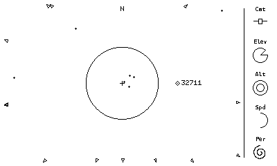

**Reference only:** two native 400×240, strictly 1-bit composites retained on
2026-10-17. The first preserves the final reviewed layout; the second substitutes
the selected station-B icon without changing anything else. Both use the wide
weather/GPS replay radar at `2026-10-10T00:00:00Z`, observer
`39.007 -104.883 2.187`, 20° vertical FOV
([reproduction inputs](../../sim/README.md#wide-radar-comparison)). Radar pixels are
unchanged apart from conversion to pure black/white. Pillow replaced the strip
with illustrative glyphs: 45° elevation cutout, mid-sized altitude ring, half
speed arc and a two-turn spiral. Neither category nor glyph values describe the
selected `32711`; the station variant is not a claim that it is a station.
These are not executable output, golden tests or physically consistent scenes.

The reviewed layout uses 24×24 glyph footprints in the existing 48px strip,
short centered `Cat`, `Elev`, `Alt`, `Spd`, `Per` labels, and equal **10px** blank
space above the top label and below the period's last ink. Label tops are at
`y=10,57,104,151,198`; glyph footprints start at `x=364`,
`y=19,68,115,162,209`. The 1px separator is at `x=352`, `y=12..227`, leaving
12px top/bottom margins and space on each side in the reviewed scene. These are
mock observations for the next comparison, not a final geometry/clearance contract.
The tiny Menlo labels are provisional rasterizations; use a crisp renderer bitmap
font before final spacing review. No temporary assets or scripts are needed to
recover this direction; the retained PNGs and text are sufficient.

## Circular elevation-only contract

[0041](../decisions/0041-circular-elevation-only-contract.md) introduced the bounded
comparison: just `Elev`, a circular cutout and the separator, with all other
slots blank. [0042](../decisions/0042-static-altitude-glyph-contract.md) now adds
altitude without changing those pixels. Elevation stays in its intended stack
slot rather than moving into the category position. The user approved a 23px circle inside the
24×24 footprint for a single-pixel hub, a crisp `FONT_6X10` label, immediate
true-state updates, and glyph/label clearing without selection while retaining
the separator. Implementation is complete and the user accepted the fresh
executable output. The retained references below are not that output;
[simulator usage](../../sim/README.md#static-elevation-glyph) owns reproduction.

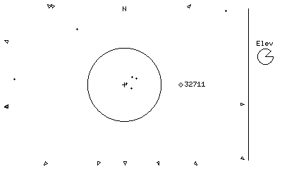

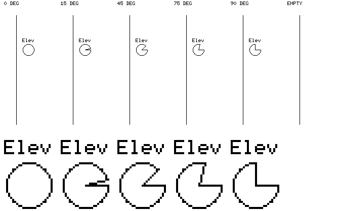

**Contract references only:** retained and approved on 2026-10-17, both strictly
1-bit. The first is a native 400×240 composite preserving every pixel of the radar portion (`x<352`)
of the retained 0038 navigation mock above. Its 45° glyph is illustrative and
is **not** a measurement of selected `32711`. The second is a 672×416 contact
sheet: six native 48×240 strips, angle/empty headings outside those strips, and
4× nearest-neighbor label/glyph details below. `EMPTY` shows only the no-selection
strip, not a complete empty-sky radar or an ingestion warning.
The 0° case is a defensive/raster endpoint, not an above-horizon selected sample.

Pillow composed these previews using 0041's explicit integer circle/line rules;
label pixels came from the existing embedded-graphics 0.8.2 `FONT_6X10` ASCII
bitmap, not a system-font approximation. No package was added. Circle endpoints
are quantized to its outline pixels; intermediate examples need not have an
exactly 15°/75° raster slope. These approved contract references are neither
simulator output, golden tests, independent physical evidence nor executable
visual acceptance. The retained images, 0041's raster specification and the
existing font asset suffice to recover the references without the disposable
generation script. Notice behavior remains 0040's accepted executable behavior,
not a new mock treatment.

## Static altitude contract

[0042](../decisions/0042-static-altitude-glyph-contract.md) now implements one static
altitude addition alongside the accepted elevation. The user approved the
concentric-circle appearance, bitmap `Alt` placement, fixed compressed mapping
and lifecycle, then separately authorized implementation. The user subsequently
reviewed and accepted the fresh executable output; the approved illustrations
below remain contract references, not that executable evidence. [Simulator usage](../../sim/README.md#static-altitude-glyph) owns fresh
executable reproduction. Category, speed and period remain outside this slice.

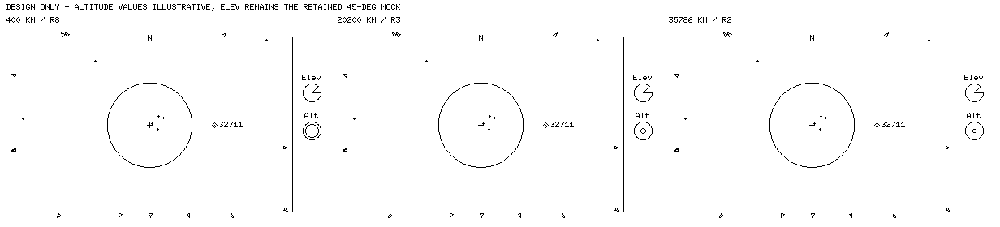

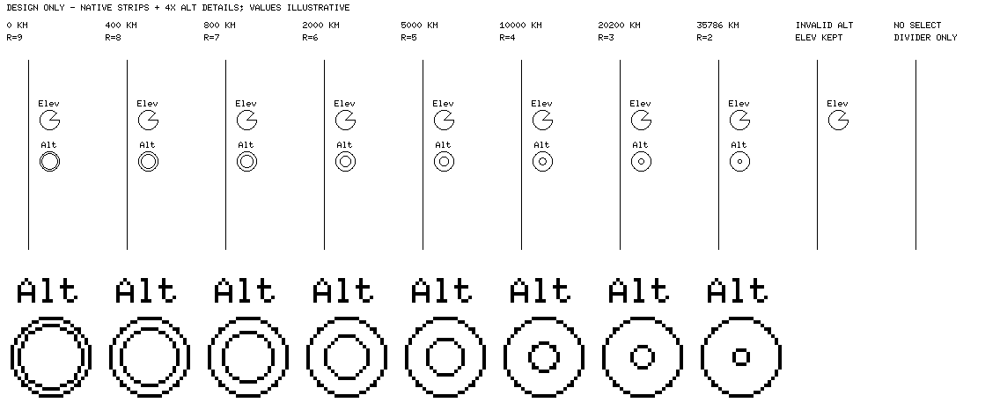

**Contract references only:** retained and approved on 2026-10-17, strictly
1-bit. The first is a 1232×280 comparison sheet containing three native 400×240
scenes, labelled outside the scenes with illustrative 400, 20,200 and 35,786 km
altitudes. Each preserves every radar pixel (`x<352`) from the retained
0041 elevation-only proposal above; its elevation remains the illustrative 45°.
Neither field is a measurement of selected `32711`. No simulator was launched
to produce these composites.

The second is a 1136×466 sheet with ten native 48×240 strips and 4× nearest-neighbor
altitude label/glyph details. The first eight demonstrate every inner radius
from 9px to 2px, using the illustrative values in 0042's table. `INVALID ALT`
retains valid illustrative elevation while omitting `Alt` and both altitude
circles. `NO SELECT` retains only the separator; it is a strip state, not a
complete empty-sky scene or a new notice treatment. Headings and values are
review annotations, not proposed on-device numeric readouts.

Pillow composed the previews using 0042's circle/mapping rules and the existing
embedded-graphics 0.8.2 `FONT_6X10` ASCII bitmap, verified against the retained
`Elev` pixels. The outer-circle pixel set matches 0041; all eight inner outlines
are connected and disjoint from it. No package was added. The retained images,
contract and font asset suffice to reconstruct the design without the disposable
preview script. These are not golden tests, independent physical evidence or
physical-display legibility/performance validation. Implementation is complete;
the user separately reviewed and accepted fresh executable output.

## Static speed contract

[0043](../decisions/0043-static-speed-glyph-contract.md) adds one static speed field
alongside elevation and altitude. The user approved instantaneous TEME velocity
magnitude, a fixed linear 0–12 km/s scale, appearance/placement, zero-label behavior
and the remaining raster/lifecycle rules, then authorized implementation. It is
implemented; the user subsequently reviewed and accepted the fresh executable
output separately from the illustrations.
[Simulator usage](../../sim/README.md#static-speed-glyph) owns reproduction.

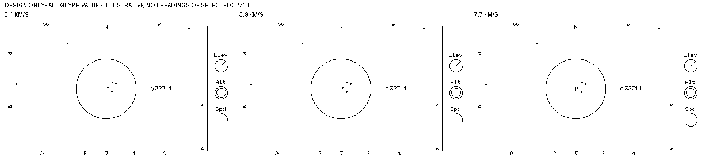

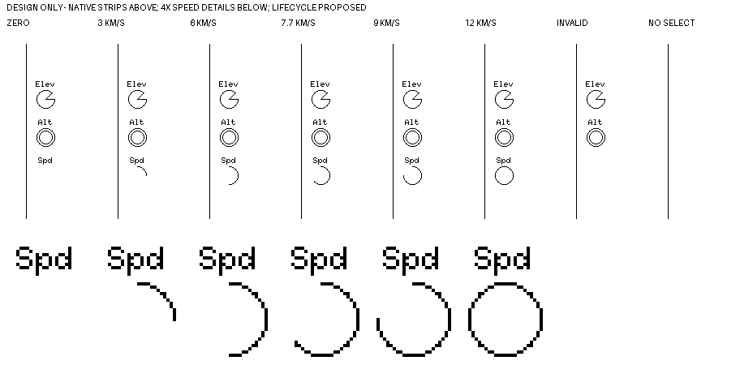

**Approved contract references only:** generated and reviewed on 2026-10-17,
retained after implementation authorization, strictly 1-bit. The first is a
1232×280 sheet containing three native 400×240 scenes. Each preserves the radar
pixels of the retained 0041 elevation proposal, including the selected `32711`.
Elevation remains the illustrative 45° cutout and altitude is an illustrative
400 km/radius-8 ring. The three speeds are illustrative too: **none of the glyph
values is a measurement of that selected object**. No simulator produced these
composites.

The second is a 912×450 sheet of eight native 48×240 strips, with enlarged 4×
nearest-neighbor speed details. Cases are zero, 3, 6, 7.7, 9 and 12 km/s, invalid
speed and no selection. Zero retains `Spd` without an arc. Invalid speed omits
only that field; no selection retains only the separator. Headings outside the
strips/scenes are review annotations, not on-device numeric readouts. The empty
strip is not an empty-sky scene or new notice treatment.

Pillow assembled these images with the existing `FONT_6X10` bitmap and 0041's
radius-11 pixel set, choosing the nearest clockwise endpoint. Checks confirmed
font parity, binary pixels and selected-scene changes confined to the new speed
slot relative to the illustrative elevation/altitude base. No dependency was
added. The retained images, 0043 and the existing font suffice to reconstruct
them without a disposable script. They are not executable snapshots, golden
tests, independent physical evidence or physical-display/performance validation.
Category, period and animation remain outside this slice.

## Static period contract

[0044](../decisions/0044-static-period-glyph-contract.md) adds one static period
spiral alongside elevation, altitude and speed. The user approved nominal
period from element-set mean motion, a fixed logarithmic scale, saturation and
invalid suppression, selected 2½ turns instead of three at the short-period
end, and approved the static lifecycle. They then authorized recording exact
raster rules and implementation. Implementation is complete; the user
subsequently reviewed and accepted fresh executable output, separately from
the illustrative comparison and scale approval. [Simulator usage](../../sim/README.md#static-period-glyph)
owns reproduction.

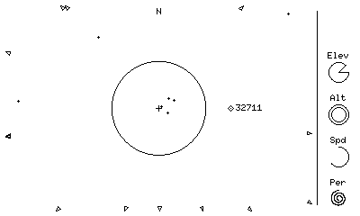

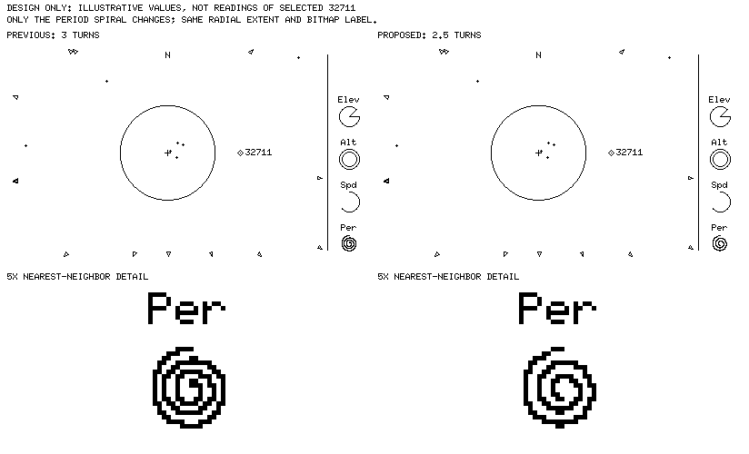

**Contract references only:** retained on 2026-10-17, strictly 1-bit. The first is
a native 400×240 illustration with a 90-minute/2½-turn spiral. The second is an
824×500 comparison with native scenes and 5× nearest-neighbor details. Its left
three-turn variant was rejected in favor of the right 2½-turn version; three
turns are not part of the approved scale. An earlier 90-minute/three-turn,
12-hour/1½-turn, 24-hour/one-turn comparison was exploration. The approved scale
now gives **1⅜ turns at 12 hours**, not 1½.

Both retained images reuse the 7.7 km/s illustrative scene from 0043 above,
preserving every existing pixel outside the period slot. Elevation is still an
illustrative 45°, altitude 400 km, and speed 7.7 km/s. **None of these values,
including period, describes selected `32711`.** Category remains blank. No
simulator output or orbital calculation was used to create these composites.

Pillow drew the sampled spiral with the existing embedded-graphics `FONT_6X10`
bitmap. Checks confirmed font parity, binary pixels, connected spiral ink,
slot bounds and unchanged pixels outside the period footprint. The 2½-turn
version keeps the preview's center and radial extent, rather than stretching
its smaller winding to fill the slot. 0044 records the exact sampling/rounding
rules; these images and the existing font are sufficient to recover the design
without a disposable script. No dependency was added. These are not executable
snapshots, golden tests, independent physical-period evidence or target
legibility/performance validation. Category and animation remain outside scope.

## Static category contract

[0045](../decisions/0045-static-group-category-contract.md) adds `Cat` and a static
Station, Navigation, Weather or Unknown icon. The user accepted the native cloud
and question mark alongside the previously selected navigation cross and station
body-and-wings. They chose explicit source-group roles with priority **Station >
Navigation > Weather > Unknown**, replacing the initial per-ID-only proposal and
conflict-to-Unknown suggestion. This selects one display role, not an exclusive
purpose or active-status claim. Uncategorized memberships do not override known
roles; no recognized role yields Unknown. The user authorized implementation,
then separately reviewed and accepted the fresh executable four-category comparison.

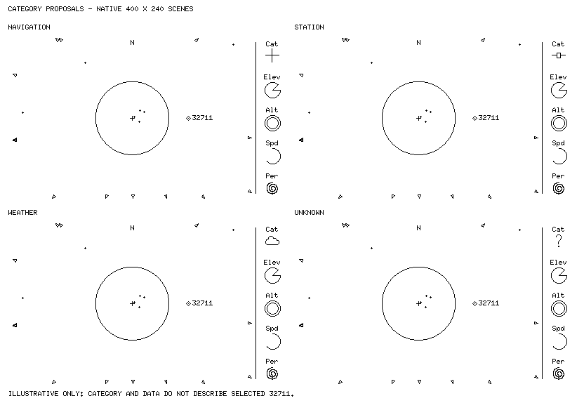

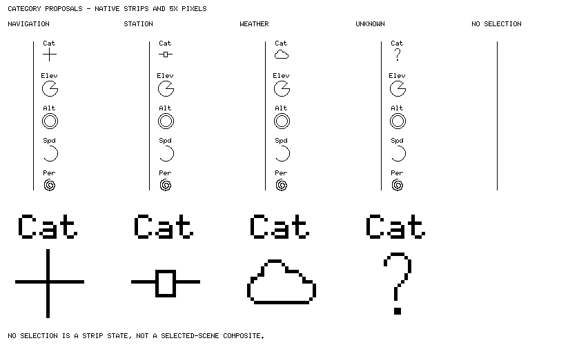

**Approved illustrative references only:** four 400×240 scenes within an 832×574
sheet, and an 852×500 strip/detail sheet. All are strictly 1-bit. Each scene reuses
the retained 0044 period proposal above, preserving every pixel outside Cat's
label/icon. Navigation/station pixels are exact copies of 0038's retained 24×24
footprints at (364,19). Pillow constructed the new cloud and question mark;
0045 records their exact row sets. Cat uses the existing embedded-graphics 0.8.2
FONT_6X10 bitmap at (367,10), baseline (367,17), with decoding checked against the
retained Elev pixels. Enlargements are 5× nearest-neighbor; headings outside the
scenes/strips are review annotations. No dependency was added for the previews.

The repeated selected 32711 does **not** acquire four roles, and the data values
remain illustrative. External research subsequently identified it as GPS BIIRM-6,
but that does not turn the old composites into executable or physical evidence.
The empty strip depicts no selection, not a complete empty-sky scene. Generation
checks confirmed binary pixels, font parity and unchanged pixels outside the
category slot. These images are not golden tests, target-performance evidence or
physical-display validation. The retained pixels, existing font and 0045 suffice
to reproduce them without disposable scripts.

The current implementation uses [group configuration](../../tools/README.md#display-categories)
and immediate selected-state lifecycle. No selection clears all five fields,
retaining the separator; selected Unknown keeps Cat and the question mark. ID
hiding and notices do not change availability. [Simulator usage](../../sim/README.md#static-category-glyph)
owns fresh executable review recipes; no animation is implied.

## Bottom-left notice reference

[0039](../decisions/0039-bottom-left-condition-driven-notices.md) selects bottom-left
notices for the revised stack, replacing the earlier unapproved radar-corner
suggestion. Notices follow their underlying conditions rather than expiring:
`NO MARKERS`, `NO FRAME`, `TRACK ERROR` and `INGEST WARN` keep their current
meanings. Healthy selected views have no notice ink. The decision owns lifecycle
details and the distinction between renderer states and simulator error handling.
[0040](../decisions/0040-white-backed-bottom-left-notice-contract.md) now implements
these notices independently of the full glyph stack. A small borderless white
backing keeps the text readable over crossing graphics. It may visually cover
markers (including the selected diamond), IDs, arrows or Earth within its bounds;
this does not change eligibility, counts, physical state or selection. Neither
text nor backing remains when no notice applies. 0040 originally preserved the
right-hand elevation capsule; 0041 now changes only that strip, leaving notices
unchanged. The user confirmed review and acceptance of the executable notice
snapshots; the composites below remain historical layout references, not that
executable evidence.

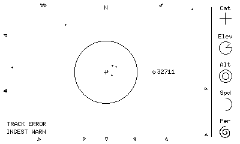

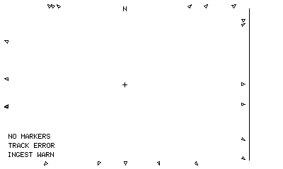

**Reference only:** native 400×240, strictly 1-bit composites retained on
2026-10-17 after the user chose bottom-left comparison B over top-left A.
Backgrounds are fresh headless weather/GPS replays at the same UTC/site as the
0038 references, at 20° and 0.1° vertical FOV respectively
([reproduction inputs](../../sim/README.md#wide-radar-comparison)). Both source
frames are healthy: the warning strings were added for layout review, not
reported by the replay. The selected strip reuses 0038's illustrative navigation
and data glyphs, replacing provisional labels with the existing renderer's
`FONT_6X10` bitmap. Glyphs still do not describe the selected satellite.

Notice ink starts at `x=12`, with 13px line spacing and the last line's ink at
`y=216..222`; the two-line example starts at `y=203`, the three-line example at
`y=190`. These observations informed 0040's subsequent geometry contract.
The retained mocks use transparent text, not the implemented white backing.
The strip retains 10px outer padding and the separator. This historical reference
did not settle full-stack clearing; 0045 subsequently accepts clearing all five
labels/glyphs without selection while retaining the separator.

The [synthetic overlap stress mock](0039-bottom-left-overlap.png) adds a
marker, ID and arrow near the notices to expose possible collisions. Those added
objects are not physical samples. Bottom-left placement alone cannot guarantee
legible warnings; 0040 subsequently resolves this with the approved local white
backing. No displacement or change to arrow geometry/selection rules follows.
No temporary assets or scripts are required to recover this direction.

## Glyph capsule reference

**Historical direction:** 0038 replaces the capsule and earlier glyph shapes
for future work. The images here remain provenance, not competing current briefs.
The [original 0032 reference](0032-glyph-radar.png) contains four independent
400×240 1-bit schematics prepared on 2026-10-15: weather/navigation/ISS/weather
examples with invented positions and illustrative values, not measured states.

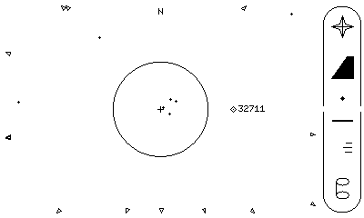

**Reference only:** retained 400×240, strictly 1-bit composite from the 2026-10-16–17
visual session. The radar is the current wide weather/GPS replay at
`2026-10-10T00:00:00Z`, observer `39.007 -104.883 2.187`, 20° vertical FOV
([reproduction inputs](../../sim/README.md#wide-radar-comparison)); its pixels are
unchanged apart from converting the light background to white. Pillow added the
illustrative navigation/elevation/altitude/speed/period stack and shared capsule
in the reserved 48-pixel strip. Glyph values are not measurements of the selected
satellite. The mock uses 6-pixel-tall side openings; its gap length, padding and
radius did not establish an implementation contract. The initial approval covered
only the wrapper treatment; 0037 below subsequently bounds the first implementation.
At the time, this image superseded the earlier reference's unboxed treatment,
not its data semantics. It is neither executable output nor a golden test.
No temporary assets or generation scripts are needed to continue.

The user subsequently approved [0037's elevation-only slice](../decisions/0037-static-elevation-glyph-contract.md):
a shortened capsule with separate space below for explicit notices, immediate
true-elevation updates, and no capsule or glyph without selection. This temporary
layout was not the full-stack mock's final geometry. The slice was implemented
and the user accepted its rendered snapshot set. 0040 subsequently relocated
only its notices to bottom-left; 0041 now replaces the capsule and filled glyph
with labelled circular elevation and the separator. 0042 adds static altitude;
0043 adds static speed, 0044 adds static nominal period and 0045 adds static
group-derived category. Reproduce the current state through the
[simulator's wide view](../../sim/README.md#static-category-glyph).
